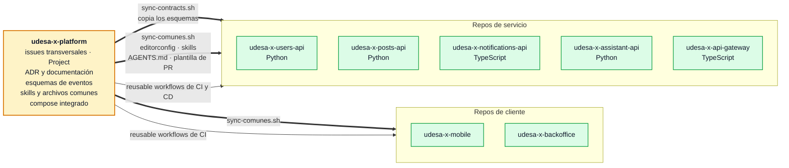
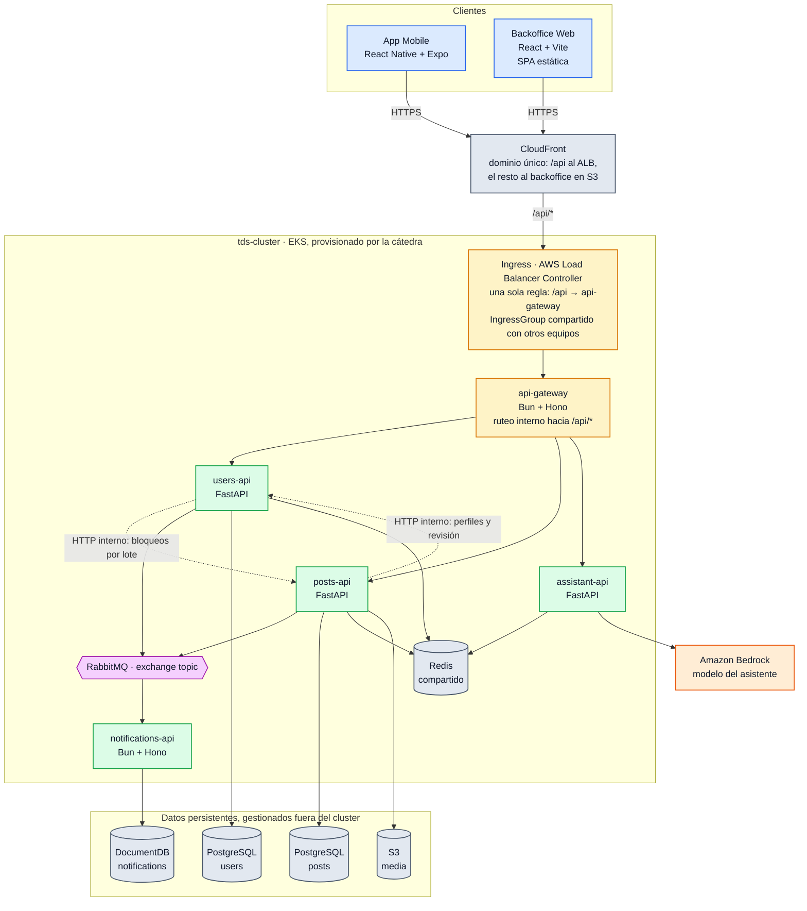
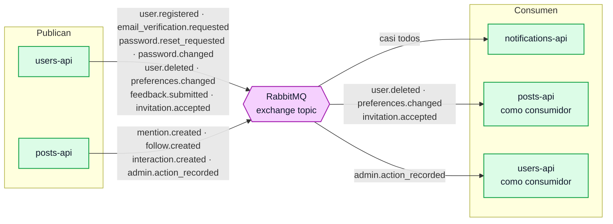
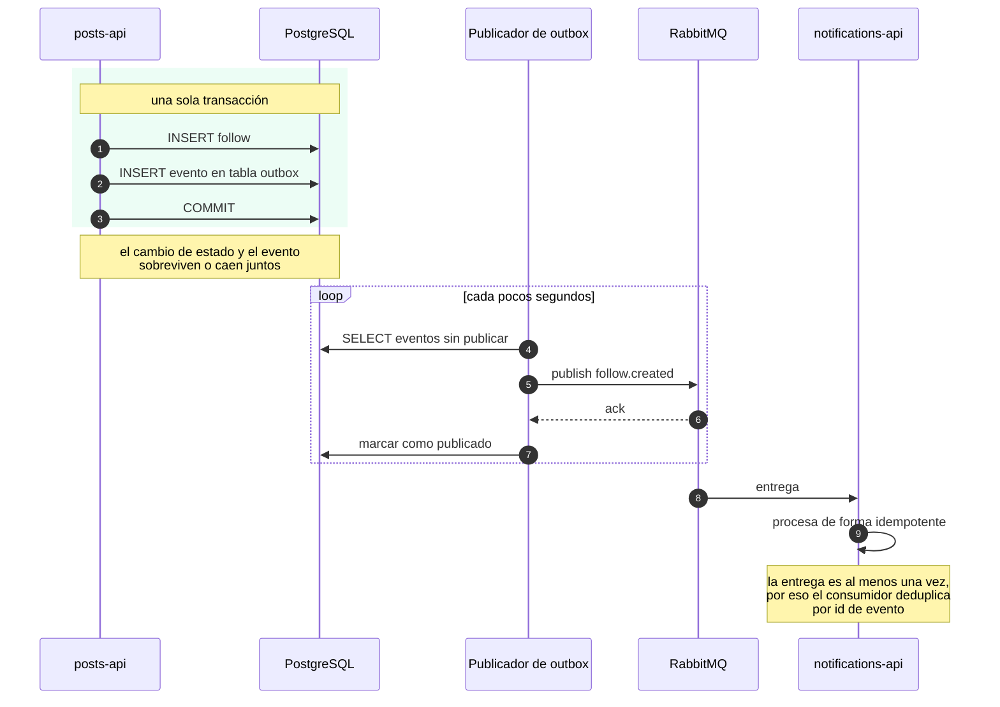
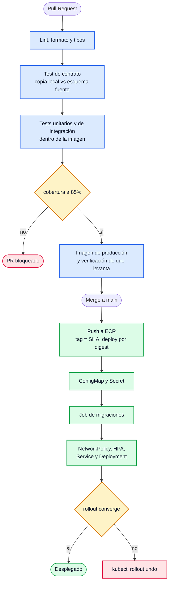
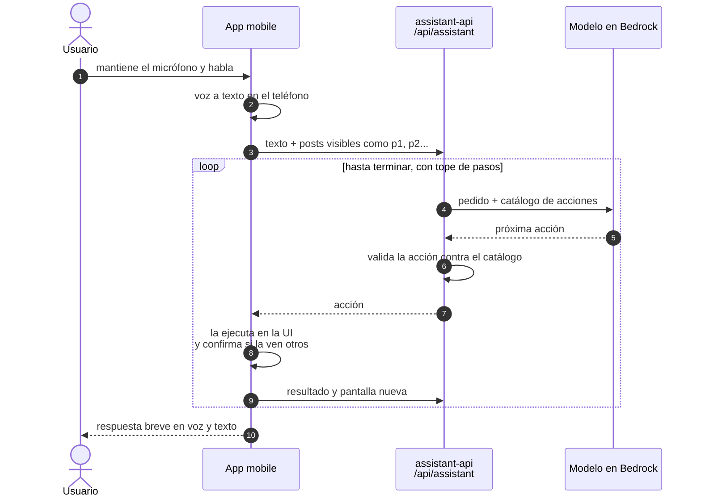

# Arquitectura de referencia de UdeSA-X

## Estado de este documento

Arrancó como propuesta. Dos decisiones las respondió el tutor por Slack el 2026-08-19, una tercera se apoya en una mención suya al pasar y falta confirmarla, y la cuarta la impone el calendario de la materia:

1. **Un repositorio por servicio.** Cada repo lleva sus tests y coverage, su pipeline de CI, sus scripts, su Docker y compose de desarrollo, y sus manifiestos de Kubernetes.
2. **Kubernetes** como plataforma de despliegue. Cerrado en el [ADR-008](./adr/ADR-008-plataforma-de-despliegue.md).
3. **Los contratos de eventos se copian** entre repos. Recomendación textual del tutor: copiar en lugar de armar librerías, para no pelear con empaquetado y publicación.
4. **AWS con EKS sobre el cluster de la cátedra.** Cerrado el 2026-09-14 en el [ADR-008](./adr/ADR-008-plataforma-de-despliegue.md): el cluster `tds-cluster` lo provisiona la cátedra en `us-east-2` y cada grupo recibe un namespace propio. Dejó sin efecto el plan B con ECS.

Las decisiones que se tomaron después están en [`docs/adr/`](./adr/README.md).

**Decisiones del equipo del 2026-08-20**, incorporadas a todo el documento:

1. **Python es el stack principal del backend.** `users-api` y `posts-api` van en Python con FastAPI, y `notifications-api` en TypeScript, sobre Bun y Hono desde el [ADR-015](./adr/ADR-015-notifications-api-en-bun-y-hono.md). La consigna pide que el backend no esté en una única tecnología y no dice cuál lleva más peso: conviene que el servicio más grande quede en el stack que el equipo maneja mejor.
2. **No hay `media-api`.** La subida de archivos se resuelve dentro de `posts-api`, que guarda las imágenes de los posts y las fotos de perfil y portada. **Son siete repositorios desde el 17 de septiembre**, cuando se sumó `udesa-x-api-gateway` para el ruteo interno que mostró la clase de Cloud Computing I.

**Revisión del stack del 2026-08-20** (superada por el ADR-008 del 14 de septiembre). En ese
momento se descartó el NGINX Ingress Controller por estar archivado y se propuso Gateway API con
NGINX Gateway Fabric como reemplazo. Esa propuesta asumía que el equipo administraba su propio
cluster; al confirmarse que el cluster es compartido y lo administra la cátedra, instalar un
controller propio quedó fuera de los permisos del grupo. La entrada real es un `Ingress` con AWS
Load Balancer Controller, ya instalado por la cátedra — ver el ADR-008.

El criterio que gobierna el documento: **elegir lo más simple que cumpla el requisito**. Tres personas en quince sprints semanales no pueden pagar el costo operativo de una arquitectura sofisticada, y con un repo por servicio ese costo se multiplica por servicio.

## Cómo se cumple cada requisito de la consigna

| Requisito                                   | Cómo se cumple                                                            |
| ------------------------------------------- | ------------------------------------------------------------------------- |
| App principal exclusivamente mobile         | React Native con Expo                                                     |
| Backoffice como aplicación web              | React + Vite, SPA                                                         |
| Arquitectura de microservicios              | 5 servicios backend (`users-api`, `posts-api`, `notifications-api`, `assistant-api` y `api-gateway`), un repositorio cada uno, despliegue independiente |
| Al menos dos tipos de base de datos         | PostgreSQL (relacional), MongoDB sobre DocumentDB (documental), Redis (clave-valor) |
| Backend en más de una tecnología            | Python con FastAPI en `users`, `posts` y `assistant`; TypeScript con Bun y Hono en `api-gateway` y `notifications` |
| Desplegada en entorno productivo en la nube | Kubernetes gestionado                                                     |
| Cada microservicio contenedorizado          | Dockerfile en cada repo, imágenes versionadas en el registry              |
| Buenas prácticas de seguridad, OWASP Top 10 | Sección "Seguridad"                                                       |
| Enfoque iterativo e incremental             | 15 sprints semanales alineados a las clases, ver `PLANIFICACION.md`       |
| Testing unitario, integración y estrés      | Sección "Estrategia de pruebas"                                           |
| Cobertura mínima del 85% ejecutada en CI    | Gate en el workflow de cada repo. Backend desde S3, clientes desde S5     |
| Pipeline de CD con GitHub Actions           | Build, push al registry y `kubectl apply` por servicio                    |
| Observabilidad con métricas, logs y trazas  | OpenTelemetry hacia Grafana Cloud; el asistente, también a Langfuse       |
| Rate limiting en al menos un microservicio  | `users-api`, `posts-api` y `assistant-api`, por usuario. No hay límite por IP en la entrada (ver "Seguridad") |
| Al menos una cola entre dos microservicios  | RabbitMQ, `posts-api` y `users-api` publican, `notifications-api` consume |
| Buena experiencia de usuario                | Sistema de diseño compartido, revisión de UX en S13                       |

## Mapa de repositorios

Ocho repositorios en `tds-g3-2s2026`, todos **públicos**. `udesa-x-assistant-api` se sumó con el asistente por voz (ADR-023). La visibilidad no es cosmética: en el plan gratuito, GitHub habilita ramas protegidas, reglas de repositorio, secrets de organización y minutos de Actions ilimitados solo en repos públicos.

| Repositorio                 | Estado    | Contenido                                          | Stack                      |
| --------------------------- | --------- | -------------------------------------------------- | -------------------------- |
| `udesa-x-mobile`            | existe    | App mobile                                         | React Native + Expo        |
| `udesa-x-backoffice`        | existe    | Backoffice web                                     | React + Vite               |
| `udesa-x-users-api`         | existe    | Identidad, perfiles, administradores               | FastAPI + Python           |
| `udesa-x-posts-api`         | existe    | Contenido, grafo social, feed, búsqueda, imágenes y fotos de perfil | FastAPI + Python           |
| `udesa-x-notifications-api` | existe    | Push, centro in-app, emails                        | Hono + Bun + TypeScript    |
| `udesa-x-assistant-api`     | existe    | Asistente por voz: relay hacia Bedrock, evaluaciones y playground | FastAPI + Python |
| `udesa-x-api-gateway`       | existe    | Ruteo interno de `/api` hacia `users-api`, `posts-api`, `notifications-api` y `assistant-api` | Hono + Bun + TypeScript    |
| `udesa-x-platform`          | existe    | Gestión, documentación, infraestructura compartida | YAML plano, GitHub Actions, docs |

**Por qué tres servicios en Python y el resto en TypeScript.** La consigna exige que el backend no esté en una única tecnología y no dice más que eso. Dado el margen, conviene que el peso caiga donde el equipo es más rápido: `posts-api` concentra casi la mitad de los puntos del sistema y ponerlo en el stack menos conocido era pagar ese costo en la parte más grande. `notifications-api` es el candidato natural para el segundo lenguaje porque es el más acotado: consume la cola, habla con FCM y con el proveedor de email, y no tiene lógica de dominio propia. Va en el mismo stack que el gateway, Bun y Hono, para que el backend tenga dos stacks y no tres ([ADR-015](./adr/ADR-015-notifications-api-en-bun-y-hono.md)). Y como mobile y backoffice son React, el equipo toca TypeScript igual todos los días. El asistente por voz suma un tercer servicio en Python, `assistant-api`, por la misma razón que `posts-api`: es el stack donde el equipo es más rápido, y el backend sigue con dos stacks ([ADR-023](./adr/ADR-023-bedrock-para-el-asistente-por-voz.md)).

**Por qué desapareció `media-api`.** Era el servicio más flojo del mapa: sin base de datos propia, era glue de I/O hacia S3, y arrastraba un repositorio entero con su CI, su gate de cobertura del 85%, sus manifiestos y su Dockerfile. Llegar al 85% en un servicio de streaming obliga a mockear S3 pesadamente, que es trabajo real a cambio de una separación que el proyecto no necesita.

La subida vive en `posts-api`, que maneja las imágenes de los posts y las fotos de perfil y portada, en el mismo bucket con prefijos distintos y con validación por magic numbers. Desaparece además la llamada cruzada entre servicios para subir un archivo, y el evento `media.orphaned`: el servicio limpia su propio storage en la misma operación que borra el registro.

### Qué contiene cada repositorio de servicio

Estructura idéntica en todos, para que moverse entre repos sea trivial. La plantilla vive en `udesa-x-platform/templates/repo-servicio/`:

```text
udesa-x-<servicio>/
├── AGENTS.md               # mapa, reglas y checks; bloque común sincronizado
├── .editorconfig           # sincronizado desde platform
├── .agents/skills/         # sincronizado desde platform
├── src/
├── tests/
│   ├── unit/
│   └── integration/
├── migrations/             # Alembic, en los servicios con PostgreSQL
├── contracts/              # esquemas de eventos, copiados desde platform
│   └── events/
├── docker/
│   ├── Dockerfile
│   └── docker-compose.dev.yml     # el servicio y sus dependencias
├── k8s/                           # YAML plano: deployment, service, configmap, secret.template, hpa
├── .github/
│   ├── workflows/                 # ci.yml, que llama a los workflows de platform
│   ├── copilot-instructions.md    # sincronizado desde platform
│   └── PULL_REQUEST_TEMPLATE.md   # sincronizado desde platform
└── README.md
```

La plantilla de `templates/repo-servicio/` es el punto de partida en Python: trae el esqueleto, el
Docker, el CI y los archivos comunes, sin `k8s/` ni `migrations/`, que cada servicio suma cuando
los necesita.

### Qué contiene `udesa-x-platform`

Es el repositorio central del proyecto, no un servicio. Concentra lo que no pertenece a ningún servicio en particular:

```text
udesa-x-platform/
├── AGENTS.md                # fuente del bloque común de todos los repos
├── .editorconfig            # fuente
├── .agents/skills/          # fuente: explicar-implementacion, revisar-pr
├── docs/
│   ├── CONSIGNA.md
│   ├── PLANIFICACION.md
│   ├── ARQUITECTURA.md
│   ├── C4.md
│   ├── GUIA-FUNCIONAL.md
│   ├── CONVENCIONES.md      # reglas del equipo y guidelines del tutor
│   ├── adr/                 # registro de decisiones de arquitectura
│   ├── eventos/             # esquemas fuente de los contratos
│   ├── actas/               # reuniones con el tutor
│   └── retros/
├── k8s/                      # el cluster lo provisiona la cátedra, no hay terraform propio
│   ├── namespace.yaml        # cuota y límites del grupo, lo aplica el docente
│   ├── ingress.yaml          # único Ingress del sistema, lo aplica el docente
│   ├── networkpolicy.yaml    # tráfico dentro del namespace, lo aplica el docente
│   ├── redis.yaml            # Redis compartido, lo aplica el CD
│   └── rabbitmq.yaml         # RabbitMQ del namespace, lo aplica el CD
├── compose/
│   └── docker-compose.full.yml    # la cola y los correos en local, con builds desde los repos
├── loadtests/               # prueba de carga del feed
├── observability/           # dashboards y alertas versionados
├── templates/
│   └── repo-servicio/       # plantilla de repositorio, incluye AGENTS.md
├── scripts/
│   ├── sync-contracts.sh    # copia los esquemas a los repos de servicio
│   ├── sync-comunes.sh      # copia editorconfig, skills, plantillas y bloque común
│   ├── validar-esquemas.sh  # valida los esquemas de docs/eventos/
│   └── seed/                # generador de datos para las pruebas de carga
└── .github/
    ├── workflows/           # reusable workflows de CI y CD
    ├── copilot-instructions.md
    └── PULL_REQUEST_TEMPLATE.md
```

Acá viven las issues **transversales**: infraestructura, documentación y decisiones. Las issues de historias de usuario viven en el repositorio donde vive su código, no acá. El tutor lo pidió explícitamente: toda rama lleva su issue asociada, y el milestone semanal se cierra con el tag del repo que efectivamente se tocó. El Project de la organización toma issues de todos los repos, así que el tablero funciona igual.

Los milestones se crean solo en los repos que tienen trabajo esa semana. Quince milestones por ocho repos serían ciento veinte y no aportarían nada; el campo Iteration del Project ya da la vista de los quince sprints.

### Cómo se relacionan los repositorios



Cada repo lleva sus propias issues y sus propios milestones semanales. `udesa-x-platform` solo concentra lo transversal y lo que se sincroniza hacia los demás.

## Vista general

**Arquitectura objetivo, no estado actual.** Este diagrama es la propuesta a la que el sistema
converge. El estado real de cada pieza —qué está desplegado hoy y qué todavía no— vive en el
Nivel 2 del C4 (`C4.md`), que se actualiza cada semana; acá abajo no se repite esa distinción
para no duplicar mantenimiento.



Lo que el diagrama deja explícito y conviene no perder de vista: **el cluster es compartido con
el resto de los equipos de la cátedra**, no propio — el `Ingress` usa un `IngressGroup` para que
todos los grupos compartan un único Application Load Balancer, y quien aplica `namespace.yaml` e
`ingress.yaml` es el docente, no el equipo. `api-gateway` es quien decide a qué servicio va cada
request; el `Ingress` ya no rutea directo a `users-api`/`posts-api` por path, tiene una sola
regla y apunta siempre a `api-gateway`. **Todo entra por CloudFront**, con un solo dominio: `/api/*`
va al ALB y de ahí al `Ingress`, y el resto al bucket de S3 del backoffice. El backoffice no se
sirve a través del cluster, y la app y el navegador del administrador le hablan a la API por ese
mismo dominio. Las bases
persistentes están fuera del cluster, mientras que Redis corre adentro porque sus datos son
efímeros y perderlos no cuesta nada. Las llamadas HTTP internas permiten leer perfiles y poner cuentas en revisión desde
`posts-api`, y consultar bloqueos por lote desde `users-api`. La consulta de bloqueos se
resuelve únicamente con el grafo local, para evitar una cadena circular de llamadas. Cada
servicio verifica el JWT contra la clave pública de `users-api`; `posts-api` además lee del Redis de `users-api` las marcas de revocación (ADR-014). El resto entre servicios cruza por la cola, y **`posts-api` es el único que
escribe en S3**: las imágenes de los posts bajo `posts/` y las fotos de perfil y portada bajo
`profiles/`.

Lo que deliberadamente **no** dibuja, para que se entienda: los eventos concretos que viajan por
la cola están en el diagrama de "Comunicación entre servicios", la telemetría en el de
"Observabilidad", y los proveedores externos que consume `notifications-api` son FCM para push y
Resend para el email.

### Correspondencia con la nube

| Componente                  | Servicio de AWS                                 | A confirmar                                                                                                              |
| --------------------------- | ----------------------------------------------- | ------------------------------------------------------------------------------------------------------------------------ |
| Cluster                     | Amazon EKS, provisto por la cátedra             | Cerrado en el ADR-008. `tds-cluster` en `us-east-2`, un namespace por grupo                                              |
| PostgreSQL de users y posts | RDS, una base y un rol por servicio             | Cerrado en el ADR-021, que reemplaza a Neon (ADR-009). Instancia de la cátedra en `us-east-2`, sin acceso público      |
| MongoDB                     | Amazon DocumentDB 8.0, `tds-group-3-docdb`      | Cerrado en `notifications-api#47`. Una instancia `db.t4g.medium`, sin acceso público, en vez de Atlas M0 por su techo de 100 operaciones por segundo (R16). Se cobra por hora aunque no se use |
| Redis                       | Dentro del cluster, uno solo                    | Cerrado en el ADR-009. Datos efímeros, separación por base lógica: `/0` para users, `/1` para posts                     |
| Almacenamiento de media     | S3 con bucket privado y URLs firmadas           | Cerrado                                                                                                                  |
| Modelo de IA                | Amazon Bedrock, inferencia dentro de EE. UU.    | Cerrado en el ADR-023: Claude Haiku 5.5 sin razonamiento, elegido con el spike de `AI-03` (`SPIKE-IA.md`) |
| Registry de imágenes        | Amazon ECR                                      | Sin ADR propio. Se publica con el commit como tag y se despliega por digest (`${ECR_IMAGE}`)                              |
| DNS y certificados          | Los resuelve la cátedra sobre el ingress        | Cerrado en el ADR-008. El equipo no administra la entrada del cluster                                                    |
| Región                      | `us-east-2`                                     | Cerrado en el ADR-008 (Ohio)                                                                                             |


## Servicios

Versiones fijadas en la revisión del 2026-08-20. Se fijan una vez y no se persiguen releases durante el cuatrimestre.

| Stack | Elección | Nota |
| ----- | -------- | ---- |
| Python, tres servicios | Python 3.13, FastAPI, SQLAlchemy 2 async con asyncpg, Alembic, uv, Ruff y pytest | Es el stack principal del backend: `users-api`, `posts-api` y `assistant-api`, este último sin base de datos. **No** usar 3.14 con free-threading: el ecosistema todavía no tiene wheels estables y un servicio web es I/O-bound, así que no hay nada que ganar |
| TypeScript, dos servicios | Bun 1.4, Hono, Vitest | `api-gateway` y `notifications-api`, con la misma versión de Bun que mobile y backoffice. En `notifications-api`, sin ORM: MongoDB con el driver oficial, que alcanza para documentos de forma variable. Ver el [ADR-015](./adr/ADR-015-notifications-api-en-bun-y-hono.md) |
| Servidor ASGI | Uvicorn con **un worker por pod** | La escala la da el HPA, no `--workers`. Con varios workers adentro del pod, uno colgado no lo detecta ningún probe |
| Imágenes | `python:3.13-slim` y `oven/bun`, multi-stage, sin root | Distroless recién en S13, cuando el pipeline esté aburrido: sin shell, depurar un pod cuesta el doble |
| Subida de archivos | `python-multipart` con streaming a S3 vía `aioboto3`, validación por magic numbers | Vive solo en `posts-api` |

### `users-api`

**FastAPI sobre Python. PostgreSQL y Redis.**

Es el primer servicio en arrancar y el que desbloquea a todos los demás. Concentra todo lo que gira alrededor de la identidad.

- Registro, verificación de email, login, logout y baja de cuenta.
- Emisión y revocación de JWT, con marcas de revocación en Redis y TTL igual a la expiración del token.
- Lockout por intentos fallidos.
- Recuperación y cambio de contraseña.
- Registro de aceptación de términos.
- Perfiles: display name, biografía y fecha de registro. La foto de perfil y la portada viven en `posts-api`.
- Preferencias: visibilidad e idioma del feed. El tema se guarda solo en el teléfono.
- Búsqueda de cuentas, feedback de los usuarios e invitaciones.
- Administradores, roles, contraseñas temporales, última conexión y auditoría.

Cubre casi toda E.1 y la administración de cuentas de E.5.

**Por qué identidad y perfil juntos:** el handle, el display name y el avatar aparecen en cada post, cada notificación y cada listado. Separarlos genera una llamada cruzada en casi toda lectura del sistema.

### `posts-api`

**FastAPI sobre Python. PostgreSQL, Redis y S3.**

Concentra contenido, grafo social, feed y búsqueda. Es el servicio más grande del sistema.

- Posts, respuestas y eliminación lógica.
- Likes y retweets con idempotencia garantizada.
- Hashtags y posts guardados. Las menciones (E2-H9) siguen abiertas.
- Relaciones de seguimiento, solicitudes pendientes, contadores.
- Bloqueos, silenciados y listas personalizadas.
- Feed cronológico paginado por cursor.
- Búsqueda de posts y usuarios.
- Trending topics sobre ventana de 24 horas.
- Denuncias, y el follow automático de una invitación.
- Subida a S3 de las imágenes de los posts y de las fotos de perfil y portada.

Cubre E2-H1 a H14 y E3-H1 a H10 salvo mensajes directos.

**Por qué el grafo y el contenido juntos:** E3-H1 CA.4 exige actualizar contadores de forma "consistente y atómica". Con el grafo en otro servicio eso obliga a una saga distribuida con compensaciones para lo que en una sola base es una transacción. Además casi toda autorización de lectura de un post depende del grafo: si la cuenta es protegida, si la sigo, si me bloqueó, si la silencié.

**Por qué el feed también:** un feed cronológico se arma de posts y follows, que ya están acá. Separarlo obligaría a mantener una proyección del grafo sincronizada por eventos, que es trabajo real y una fuente de inconsistencias, a cambio de una separación que el volumen del proyecto no necesita.

**Búsqueda:** coincidencia literal con `ILIKE` e índices GIN `pg_trgm`. `posts-api` busca publicaciones y respuestas; `users-api` busca nombre visible o handle en su propia base y consulta bloqueos por lote en `posts-api`. Se requieren tres caracteres, el orden es por fecha de creación e id descendentes y cada página contiene hasta veinte resultados autorizados. Un `@` inicial restringe la búsqueda de cuentas al handle. Los snippets son texto segmentado con resaltado y hasta 160 caracteres visibles. La búsqueda no aplica stemming, similitud ni normalización de acentos.

**Trending:** consulta de agregación sobre los hashtags de posts y respuestas de las últimas 24 horas, cacheada en Redis con TTL de 15 minutos, que es exactamente lo que exige E2-H11 CA.3. Solo cuentan los posts de cuentas públicas no eliminadas, y el ranking es único para todos los espectadores: por eso la caché es compartida y no por usuario. El endpoint es `GET /api/trending`, que el gateway enruta a `posts-api`.

### Borrado de publicaciones y retención

El autor puede eliminar sus publicaciones y respuestas, con confirmación y sin restauración.
El borrado lógico registra `deleted_at` una sola vez y conserva el texto en almacenamiento;
ninguna lectura pública devuelve ese texto. El contenido deja de aparecer en el feed y en
los listados de publicaciones. El detalle y las respuestas de un hilo conservan un marcador
con `deleted: true` y `content: null`, tenga o no respuestas el post eliminado. Las reglas de
privacidad y bloqueos siguen aplicándose al marcador y a cada respuesta.

Las respuestas existentes mantienen su contenido, sus vínculos y su posición. Borrar una
respuesta no la descuenta del contador del padre porque conserva su marcador. Se puede
recorrer el hilo y responder a publicaciones activas, pero no responder directamente al
marcador ni darle like, retweetearlo o generar una denuncia nueva sobre él.

El borrado elimina las relaciones de likes y retweets y pone ambos contadores en cero dentro
de la misma transacción. Las denuncias existentes y sus referencias se conservan; esta política
no agrega una copia del texto como evidencia. Las publicaciones creadas siguen contando en
las métricas históricas. La limpieza por moderación es una operación distinta del borrado por
el autor y no concede a administradores permisos adicionales sobre este último.

El plazo de conservación del texto, la purga física, los backups y el borrado de cuentas
permanecen pendientes de definición con el grupo y el tutor. No hay purga automática ni un
compromiso de eliminación a los treinta días. El comportamiento de publicaciones aquí definido
no implica aprobación del tutor ni resuelve la política general de privacidad.

### `notifications-api`

**Bun y Hono sobre TypeScript. MongoDB, sobre DocumentDB.** Se despliega desde el 2026-11-13. Mismo stack que el gateway ([ADR-015](./adr/ADR-015-notifications-api-en-bun-y-hono.md)). Es deliberado que este servicio aporte el segundo lenguaje junto al gateway: es acotado, no tiene lógica de dominio propia, y el cliente oficial de FCM, `firebase-admin`, funciona sobre Bun.

Es el consumidor principal de la cola y el que justifica la segunda base de datos.

- Consume eventos y decide qué notificar.
- Consulta preferencias antes de enviar, como exige E4-H5 CA.2.
- Envía push por FCM, gestiona y depura device tokens.
- Expone `/api/notifications` detrás del gateway, para lo que la app le pide directo: el registro del device token después de cada login (`POST /api/notifications/device-tokens`, E4-H1 CA.3), el centro in-app y las preferencias de notificación. Valida el JWT de `users-api` con la clave pública (firma, vencimiento y emisor) y no lee las revocaciones: un token cerrado sirve hasta que vence. Es la decisión D1 de E4-H1; el ADR-014 sigue aplicando solo a `posts-api`.
- Persiste el historial in-app, paginado y con borrado lógico.
- Envía todos los emails salientes: verificación, recuperación, cambio de contraseña y feedback. La alerta de servicio caído la manda Grafana (ADR-012).

Cubre E.4, más el envío de emails de E1-H1, H5, H11 y H13.

MongoDB encaja porque las notificaciones tienen forma variable según el tipo, se escriben mucho, se leen paginadas por usuario y se archivan.

### `assistant-api`

**FastAPI sobre Python, sin base de datos.** El asistente por voz ([ADR-023](./adr/ADR-023-bedrock-para-el-asistente-por-voz.md)): recibe el pedido y la pantalla de la app, llama al modelo en Amazon Bedrock y devuelve la próxima acción del catálogo. En el repo viven también las evaluaciones, los tests con un modelo falso y el playground. El detalle está en "Integración de Inteligencia Artificial".

### Subida de archivos: dentro de `posts-api`, no en un servicio aparte

| Qué | Dónde | Prefijo en S3 |
| --- | --- | --- |
| Foto de perfil y portada | `posts-api` | `profiles/` |
| Imágenes de post | `posts-api` | `posts/` |

El plan era que cada servicio subiera lo suyo, con el módulo escrito en `users-api` y copiado a
`posts-api`. Terminó todo en `posts-api`, que ya manejaba las imágenes y sus URLs firmadas.

Qué hace, que es lo que exigen los criterios de aceptación:

- Recibe por stream, sin cargar el archivo en memoria: E1-H8 CA.7.
- Valida el tipo real por magic numbers, no por extensión: E1-H8 CA.3 y E2-H7 CA.3.
- Valida tamaño según destino: 5 MB foto de perfil, 10 MB portada, 1 MB por imagen de post.
- Borra el archivo anterior al reemplazar, después de confirmar el cambio en la base: E1-H8 CA.4.
  Si S3 falla en ese paso, el archivo queda suelto y se registra un aviso.

**Se mantuvo el stream por el servicio.** La alternativa era una URL prefirmada para que el
cliente suba directo a S3, más barata, pero entonces el servidor nunca ve el archivo y ni E1-H8
CA.7 ni CA.3 se cumplen como están redactados.

## Comunicación entre servicios

### Sincrónica

REST sobre HTTP con JSON, solo cuando la respuesta se necesita dentro del request. Se limita al mínimo:

- El Gateway a cualquier servicio.
- `posts-api` a `users-api` para leer el perfil público de una cuenta y la identidad de un administrador.
- `posts-api` a `users-api` para poner una cuenta en revisión cuando junta denuncias de 6 cuentas distintas (`E3-H5`). Va a una ruta interna fuera de `/api` con el header `X-Internal-Token`; ver el ADR-011.
- `posts-api` a `users-api` para levantar esa revisión cuando el backoffice descarta o resuelve el caso (`E5-H7`). Misma ruta interna con `DELETE` y el mismo header; ver el ADR-020.
- `users-api` a `posts-api` para consultar bloqueos por lote al buscar cuentas.
- `backoffice` a los healthchecks de `users-api`, `posts-api`, `notifications-api` y `assistant-api`, para E5-H11. Pasa por el Gateway: `/api/health/<servicio>` se traduce al `/healthcheck` de cada uno, que vive fuera de `/api` y no se alcanza desde afuera del cluster.

Toda llamada sincrónica entre servicios lleva un timeout de 2 segundos y un reintento, con comportamiento definido ante fallo del destino. En Kubernetes esto se apoya en los probes: un servicio sin `readinessProbe` en verde no recibe tráfico.

### Formato de error

Todas las respuestas de error de los tres servicios usan **Problem Details**, definido por la
RFC 9457, que obsoleta a la RFC 7807 y conserva el mismo medio: `application/problem+json`.

```json
{
  "type": "https://udesa-x.dev/errors/validation-failed",
  "title": "La solicitud tiene campos inválidos",
  "status": 422,
  "detail": "El handle debe tener entre 4 y 15 caracteres",
  "instance": "/api/me",
  "traceId": "0af7651916cd43dd8448eb211c80319c",
  "errors": [{ "field": "handle", "message": "longitud fuera de rango" }]
}
```

Los cinco primeros campos son los de la RFC. El equipo agrega dos:

| Campo | Para qué |
|---|---|
| `traceId` | El `trace_id` de OpenTelemetry. Es lo que permite que alguien reporte un error y se llegue a la traza exacta sin buscar por timestamp |
| `errors` | Solo en validación. Una entrada por campo, para que el cliente marque los inputs sin parsear prosa |

**El `detail` no expone nada interno.** Ni stack traces, ni nombres de tabla, ni si un registro
existe. Esto no es prolijidad: `E1-H2 CA.3` exige que ante credenciales incorrectas el mensaje
sea genérico para evitar enumeración de usuarios, y es el criterio A10 del mapeo OWASP. El
detalle real va al log con el mismo `traceId`.

**Dos excepciones, y son a propósito:**

- **`/healthcheck` no usa este formato.** Su `503` lo consume el `readinessProbe` de
  Kubernetes y el backoffice para `E5-H11`, no un usuario. Devuelve el estado de cada
  dependencia, que es lo que sirve para diagnosticar. Hacia el backoffice, el Gateway deja
  pasar solo el estado y la versión: el detalle puede traer el texto de un error de conexión
  y no sale del cluster.
- **Las respuestas exitosas tampoco.** Problem Details describe errores; un `200` devuelve el
  recurso y nada más.

Se implementa una vez como manejador de excepciones y se repite en `users-api`, `posts-api` y
`assistant-api`. En `notifications-api` es el `onError` de Hono, equivalente.

### Paginación por cursor

Un único formato para todo listado que puede superar una pantalla: `GET /api/users/{user_id}/followers`, `GET /api/users/{user_id}/following` y `GET /api/follow-requests` lo usan desde S4 en `posts-api`, y el feed cronológico de `E2-H2` lo va a reusar.

**Por qué no `LIMIT`/`OFFSET`.** El offset cuenta posiciones. Si alguien te sigue mientras scrolleás la lista de seguidores, o llega un post nuevo mientras scrolleás el feed, el corrimiento hace que la página siguiente repita o saltee elementos. Un cursor no cuenta posiciones: recuerda la fila exacta en la que terminó la página anterior y pide lo que sigue después de esa fila, así que una escritura en cualquier otro lugar no lo afecta.

**Forma de la respuesta**, igual en todos los listados paginados:

```json
{
  "items": [ "..." ],
  "nextCursor": "eyJhdCI6ICIyMDI2LTA5LTIwVDEyOjAwOjAwWiIsICJ0aWVicmVhayI6ICIuLi4ifQ=="
}
```

`nextCursor` es `null` cuando no queda una página siguiente. El cliente lo devuelve tal cual en `?cursor=`, sin interpretarlo: es opaco a propósito, para poder cambiar la columna de orden más adelante sin romper a ningún cliente que ya lo esté usando.

**Adentro del cursor** (no es parte del contrato, es detalle de implementación): la columna de orden más un id de desempate, en base64. El desempate es obligatorio — dos filas con el mismo timestamp sin un id que las distinga pueden aparecer dos veces o ninguna.

**Página de 20**, fija, no configurable por query param. Un cursor inválido o corrompido responde `400` con el formato de "Formato de error" de arriba (`code: invalid-cursor`), nunca un `500`.

**Toda consulta paginada necesita un índice que la sostenga.** La combinación filtro más columna de orden más desempate tiene que ser exactamente las columnas del índice, en ese orden, o el `EXPLAIN` cae a `Seq Scan` apenas la tabla crece.

**El wire es camelCase en toda esta familia de endpoints** (`/users/*/follow*`), no solo en la paginación: `nextCursor`, `requesterHandle`, `createdAt`, `displayName`, `avatarUrl`, `following`. Viene de antes de T-30 (PR #34 de `posts-api`) y se mantuvo al extenderlo, así que no es una excepción de esta convención sino el formato ya establecido para esta parte de la API.

### Versionado de la API

**Hoy todo cuelga de un único prefijo, `/api`, sin número de versión.** `/api/auth/login`,
`/api/me`, `/api/users/{user_id}/followers`, así en todos los servicios. Reemplaza a la
propuesta original de esta sección, que ponía la versión en el path (`/v1/...`): el prefijo
`/api` nació de una necesidad de ruteo (`#43`, `#35`, `#25`, el `Ingress` compartido rutea por
ese prefijo) y terminó siendo también el esquema de versionado de hecho, al no convivir con
ningún `/v1`.

**No hay versionado todavía, y está bien que no lo haya:** con un solo cliente mobile y un
backoffice, ambos controlados por el propio equipo, forzar una versión desde el día uno es
resolver un problema que no existe. El día que haga falta (un cambio incompatible real), la
versión se agrega como un segmento nuevo bajo el prefijo ya establecido: `/api/v2/...`, dejando
`/api/...` de hoy como la `v1` implícita.

**Qué obliga a subir de versión:**

| Rompe | No rompe |
|---|---|
| Quitar o renombrar un campo de la respuesta | Agregar un campo a la respuesta |
| Volver obligatorio un campo que era opcional | Agregar un endpoint |
| Cambiar el tipo o el significado de un campo | Agregar un parámetro de query opcional |
| Quitar un endpoint o un valor de enum | Relajar una validación |
| Agregar una validación que antes no existía | Agregar un valor de enum en un campo de entrada |

La regla que hace segura la columna derecha: **los clientes ignoran los campos que no
conocen.** Sin eso, agregar un campo rompe, y toda evolución pasa a necesitar versión nueva.

**Durante el semestre se trabaja solo con el `/api` de hoy, la `v1` implícita.** Si aparece un cambio incompatible, se acuerda
en el planning antes de escribirlo, porque la app mobile es el caso duro: una versión instalada
sigue llamando al endpoint viejo y no se le puede forzar la actualización. La salida es
convivir las dos versiones un tiempo, no cortar.

**Los endpoints operativos quedan fuera del namespace versionado**: `/healthcheck` y las
métricas no son contrato con el cliente y no versionan.

**Los eventos de la cola versionan aparte**, con la versión adentro del propio evento y no en
un path: es parte del `type` del sobre de CloudEvents (`follow.created.v1`), que también es la
routing key. Un cambio compatible mantiene el `type`; uno incompatible es un evento nuevo
(`.v2`), y el publicador manda las dos versiones mientras haya consumidores de la anterior. La
política completa está en [`docs/eventos/`](./eventos/README.md) y en el
[ADR-017](./adr/ADR-017-forma-y-versionado-de-eventos.md).

### Asincrónica

RabbitMQ 4.x desplegado en el cluster, con exchange de tipo topic. Elegido sobre Kafka porque es mucho más simple de operar, tiene interfaz de administración que sirve para demostrar el requisito, y tiene clientes maduros en Node y en Python. NATS JetStream es operativamente más simple, pero su interfaz de administración no iguala al management plugin de RabbitMQ, y acá el requisito es demostrar la cola. En el cluster corre la imagen sin el plugin, para ahorrar memoria (`platform#135`); la consola queda en el compose local.

**Las colas se declaran `quorum` explícitamente**, junto con la dead letter queue vía `x-dead-letter-exchange`. RabbitMQ 4.0 removió las classic mirrored queues: si nadie declara el tipo, se termina con colas sin replicación sin que nadie lo note.

**Cuándo entra.** La cola se levanta en **S4**, no antes, porque hasta que existe `notifications-api` el único consumidor posible sería el propio publicador y no cumpliría el requisito de la consigna de comunicar dos microservicios. En S2 los emails de cuenta se mandaban sincrónicos desde `users-api`, detrás de una interfaz. En S4 los casos de uso dejan de mandar emails y escriben su evento en el outbox; `notifications-api` es el único que habla con Resend.

| Evento                         | Publica      | Consume                                    |
| ------------------------------ | ------------ | ------------------------------------------ |
| `user.registered`              | users        | notifications (email de verificación)      |
| `email_verification.requested` | users        | notifications (reenvío de la verificación) |
| `password.reset_requested`     | users        | notifications                              |
| `password.changed`             | users        | notifications                              |
| `user.deleted`                 | users        | posts, notifications                       |
| `preferences.changed`          | users        | posts (filtro de idioma del feed)          |
| `feedback.submitted`           | users        | notifications                              |
| `invitation.accepted`          | users        | posts (follow del invitado al invitador)   |
| `mention.created`              | posts        | notifications (menciones)                  |
| `follow.created`               | posts        | notifications                              |
| `interaction.created`          | posts        | notifications                              |
| `admin.action_recorded`        | posts        | users (auditoría)                          |

La tabla nombra los eventos sin versión. El contrato de cada uno, con su versión, vive en
[`docs/eventos/`](./eventos/README.md) desde que tiene publicador; `servicios.json` declara qué
publica y consume cada servicio, y es lo que se copia a cada repo.



`posts-api` y `users-api` aparecen dos veces a propósito: publican y consumen. `posts-api` reacciona a la baja de una cuenta, al cambio de idioma del feed y a una invitación aceptada; `users-api` guarda en su auditoría las acciones administrativas que pasan en `posts-api`.

**Patrón outbox:** los servicios que publican escriben el evento en una tabla `outbox` dentro de la misma transacción que el cambio de estado, y un proceso aparte lo publica. Sin esto, un crash entre el commit y el publish deja el sistema inconsistente en silencio.

El outbox es el mecanismo que hace confiable la publicación, y no se entiende de la descripción:



Sin outbox, un crash entre el `COMMIT` y el `publish` deja un follow persistido que nadie va a notificar, y el sistema queda inconsistente en silencio. Con outbox el peor caso es publicar dos veces, que el consumidor idempotente absorbe.

Tres detalles de implementación que no son opcionales:

1. El publicador lee con `SELECT ... FOR UPDATE SKIP LOCKED`, para que dos réplicas no tomen el mismo evento.
2. Un trigger con `pg_notify` despierta al publicador apenas se inserta la fila. El polling periódico queda como red de seguridad si se cae la conexión de `LISTEN`. Esto baja la latencia a casi cero sin agregar CDC ni Debezium, que exigirían Kafka Connect en el cluster.
3. La deduplicación del consumidor usa el id del evento como clave primaria, y el registro va **en la misma operación atómica** que el efecto de negocio cuando el efecto vive en la misma base. Así el at-least-once del broker se vuelve exactly-once desde la perspectiva del negocio, sin librerías. Cuando el efecto es externo, como un email, no hay transacción que lo abarque: `notifications-api` guarda un documento por evento en estado `pending` antes de enviar y lo cierra en `sent` o `failed` después. Un repetido cerrado se descarta; uno `pending` se reenvía, porque perder el email es peor que mandarlo dos veces.

### Contratos de eventos: copiados, no empaquetados

Por indicación del tutor, los esquemas se copian en lugar de publicarse como librería. El esquema fuente vive en `udesa-x-platform/docs/eventos/`, y `scripts/sync-contracts.sh` lo copia a `contracts/events/` de cada repo de servicio.

El riesgo real de copiar no es duplicar, es **divergir en silencio**. Se mitiga sin empaquetar nada: cada servicio tiene un test de contrato que valida su copia local contra el esquema, y el CI de cada servicio compara su copia con `docs/eventos/` de platform (`ci-python.yml` y `ci-node.yml`). Si alguien edita su copia sin propagar, el pipeline lo detecta. Es la mitad del beneficio de una librería compartida sin nada del costo de publicación.

## Bases de datos

| Base       | Tipo        | Servicios     | Por qué                                                                                     |
| ---------- | ----------- | ------------- | ------------------------------------------------------------------------------------------- |
| PostgreSQL | Relacional  | users, posts  | Integridad referencial, transacciones, contadores atómicos, búsqueda de texto con `pg_trgm` |
| MongoDB    | Documental  | notifications | Documentos de forma variable por tipo, escritura intensiva, lectura paginada por usuario. Corre sobre DocumentDB |
| Redis      | Clave-valor | users, posts, assistant | Revocación de JWT, contadores de rate limit, caché de trending                    |

**PostgreSQL 18**, que es la versión de la instancia de RDS (18.3). Trae `uuidv7()` como función nativa, y esa es la clave primaria de `posts`: mantiene los inserts append-mostly en el índice, da cursor cronológico implícito y no expone IDs adivinables en un feed público, que es lo que pasaría con `bigserial`. Hay que fijarlo antes de la primera migración, después cuesta mucho más.

**MongoDB es Amazon DocumentDB 8.0** y no Atlas M0, que topea en 100 operaciones por segundo, 0.5 GB y 500 conexiones: las pruebas de carga contra `notifications-api` habrían chocado contra ese techo y no contra el sistema (R16). Un cluster `tds-group-3-docdb` con una instancia, en la VPC del cluster y alcanzable solo desde los pods, como RDS. El servicio entra con el usuario `notifications`, que solo tiene `readWrite` sobre su base y lo crea el workflow `crear-usuario-documentdb.yml`.

Cada servicio es dueño exclusivo de su esquema y **ningún servicio consulta la base de otro**. Esto no es purismo: es lo que hace que el desacoplamiento sea real y no solo estructura de carpetas.

Las bases persistentes corren **fuera del cluster**, como servicios gestionados: una instancia de RDS con una base y un rol por servicio, según el ADR-021, y un cluster de DocumentDB para `notifications-api`. Operar PostgreSQL con estado dentro de Kubernetes agrega volúmenes persistentes, backups y failover, que es una materia entera y no aporta nada a la nota. **Redis es la excepción y corre adentro**, uno solo para los dos servicios, con la base lógica `/0` para users, `/1` para posts y `/2` para assistant (con una sola excepción, de solo lectura: `posts-api` consulta en `/0` las marcas de revocación, ADR-014): guarda revocación de JWT, contadores de rate limit y caché, todo efímero y con TTL, así que perderlo ante un reinicio no rompe nada y no justifica pagar un servicio gestionado. La correspondencia concreta con los servicios de AWS está en la tabla de la sección "Vista general".

Migraciones versionadas y ejecutadas como Job de Kubernetes antes del rollout: **Alembic en los dos servicios de Python**. `notifications-api` usa MongoDB y no lleva migraciones de esquema. Una sola herramienta de migraciones en todo el proyecto es una consecuencia directa de haber concentrado el backend relacional en Python, y ahorra mantener dos flujos distintos.

**Cuándo entran: ya entraron.** La regla anterior, fijada por el tutor el 8 de septiembre, era crear las tablas desde los modelos con `Base.metadata.create_all()` mientras no hubiera base desplegada, porque sin datos vivos no hay nada que una migración proteja. El ADR-009 la termina: con las bases creadas, todo cambio de esquema es una revisión de Alembic.

Los dos servicios ya están ahí. `users-api` trae Alembic desde S2, `posts-api` lo incorporó con su `0001_esquema_actual.py`, y los `conftest.py` de ambos levantan el esquema con `alembic upgrade head`: no queda una llamada a `create_all` en `src/` ni en `tests/`. La `0001` de cada servicio queda congelada con el primer deploy, y desde ahí editarla o correr `alembic stamp` contra una base con datos queda prohibido. Lo que ya rige hoy es que un cambio de modelo llega con su migración en el mismo PR: `alembic check` lo detecta y los tests de integración lo prueban.

`deploy.yml` corre un despliegue por servicio a la vez, así que dos migraciones del mismo servicio no se pisan. Los cambios van en expand y contract, en deploys separados: primero lo aditivo, el `DROP` o el `NOT NULL` en un deploy posterior. El rollback es forward-only: las down-migrations casi nunca se prueban y fallan justo cuando se las necesita.

## Aplicaciones cliente

### Mobile

**React Native con Expo.**

| Aspecto            | Elección                                                        |
| ------------------ | --------------------------------------------------------------- |
| SDK                | Expo 54, con React Native 0.81 y React 19.1                     |
| Navegación         | Expo Router                                                     |
| Estado de servidor | TanStack Query v5, con scroll infinito nativo                   |
| Estado global      | Zustand                                                         |
| JWT                | `expo-secure-store`                                             |
| Push               | `expo-notifications` sobre FCM                                  |
| Tests              | Jest y React Native Testing Library 13                          |
| E2E                | Ninguno: se descartó en `udesa-x-platform#89`                   |
| Distribución       | EAS Build, APK para Android. Sin build de iOS                   |

Expo resuelve tres cosas que el proyecto necesita y que en React Native puro cuestan semanas: build en la nube sin Xcode ni Android Studio, distribución al tutor y configuración de push.

### Backoffice web

**React 19 con Vite 8 y TypeScript.** SPA, sin renderizado en servidor: un panel interno no necesita SEO.

| Aspecto            | Elección                                     |
| ------------------ | -------------------------------------------- |
| Estado de servidor | TanStack Query v5                            |
| Ruteo              | TanStack Router                              |
| Componentes        | Mantine                                      |
| Tests              | Vitest 4 y Testing Library                   |
| Compilador         | React Compiler activado desde S1              |

Mantine sobre shadcn porque trae formularios y gráficos en el mismo monorepo con versionado en lockstep, y con quince semanas el pegamento entre librerías es justamente lo que consume sprints. El React Compiler es estable desde octubre de 2025 y elimina una clase entera de bug para quien está aprendiendo React: `useMemo` y `useCallback` mal puestos.

**La búsqueda mobile integra TanStack Query v5 con los clientes Axios autenticados existentes.** Las consultas se separan por cuenta, tipo y texto, se cancelan al cambiar de sesión y se revalidan al recuperar foco. No persisten resultados en el dispositivo.

**La generación de clientes REST con Orval es una capacidad prevista.** Los tres servicios ya exponen OpenAPI, y con Orval cada repo cliente genera tipos, cliente y hooks de TanStack Query contra ese esquema, y commitea lo generado. Un cambio de contrato aparece como diff en el PR. Es el mismo criterio que la decisión A3 del tutor para los eventos: nada que publicar, la divergencia se ve en la revisión.

## Infraestructura y despliegue

### Kubernetes

| Componente   | Elección                                      | Notas                                                                                             |
| ------------ | --------------------------------------------- | ------------------------------------------------------------------------------------------------- |
| Cluster      | `tds-cluster`, EKS, provisionado por la cátedra | Compartido con el resto de los equipos, un namespace por grupo. Cerrado en el ADR-008              |
| Nodos        | Compartidos, gestionados por la cátedra       | El equipo no elige tipo de instancia ni escalado de nodos: eso es de la cátedra                   |
| Manifiestos  | YAML plano en `k8s/` por repositorio          | Cerrado en el ADR-008. Un solo entorno y un solo namespace no justifican overlays                 |
| Entrada      | **`Ingress` único, aplicado por el docente**  | Reemplazado en el ADR-008. Instalar un gateway controller excede los permisos del grupo            |
| TLS          | ACM, vía annotations del `Ingress`            | `certificate-arn` + `ssl-redirect`, ya configurado por la cátedra en el ALB compartido             |
| Secretos     | **GitHub Secrets**, volcados por `deploy.yml` | Cero pods extra en el cluster. El pipeline arma el Secret de cada servicio                         |
| Registry     | Amazon ECR                                    | Sin ADR propio. Se publica con el commit como tag y se despliega por digest (`${ECR_IMAGE}`)   |
| Identidad    | OIDC + IRSA                                   | Vista en la clase de Cloud Computing I: el pod asume un IAM Role vía ServiceAccount anotado        |
| Autoescalado | HPA por CPU en `users-api` y `posts-api`      | De 1 a 2 y de 1 a 3 réplicas, dentro de la cuota del namespace (README de platform, con la prueba del 13/11). KEDA para `notifications-api` espera a que la cátedra lo instale |

**Por qué cambia el ingress.** El repositorio `kubernetes/ingress-nginx` está archivado desde el 24 de marzo de 2026 y su README dice textualmente que quien no lo esté usando ya no debería desplegarlo. No va a haber más parches de seguridad, y antes de cerrar acumulaba seis CVEs en cuatro meses. Lo traicionero es que no se rompe: funcionaría perfecto los quince sprints. La API `Ingress` de Kubernetes no está deprecada: lo que murió es ese controller.

El primer reemplazo evaluado fue NGINX Gateway Fabric, instalado por el propio equipo. Quedó
descartado al confirmarse (ADR-008) que el cluster es compartido y administrado por la cátedra:
el equipo no tiene permisos para instalar un controller propio, solo para editar recursos dentro
de su namespace. El reemplazo real es el AWS Load Balancer Controller que la cátedra ya tiene
instalado, consumido a través de la misma API `Ingress` de Kubernetes.

**Por qué GitHub Secrets.** El plan original era SOPS con age, pensado para destruir y recrear un cluster propio entre sprints. Con el cluster de la cátedra (ADR-008) ese caso no existe: los valores viven como GitHub Secrets y `deploy.yml` arma el Secret de cada servicio.

**Por qué KEDA.** El HPA por CPU no puede demostrar lo que interesa. KEDA permite mostrar cero pods, publicar mensajes en la cola y verlos aparecer. Dos advertencias que ahorran horas: nunca definir un HPA propio sobre el mismo Deployment que un `ScaledObject`, y el vhost de RabbitMQ hay que URL-encodearlo. El cluster de la cátedra todavía no lo tiene instalado: lo sigue `udesa-x-notifications-api#46`.

### Costo: los números reales

**Obsoleto desde el ADR-008.** Esta tabla asumía que el equipo paga y elige los nodos de su
propio cluster. El cluster real (`tds-cluster`) lo provisiona y paga la cátedra, compartido con
los demás equipos — no hay un costo de cómputo que el equipo decida o cubra. Queda como registro
histórico de la estimación previa al 14 de septiembre, no como presupuesto vigente.

Verificados el 2026-08-20 contra la Price List API, en `us-east-1` (anterior a que el ADR-008
fijara `us-east-2` como la región real del cluster de la cátedra):

| Configuración                                              | USD/mes    |
| ---------------------------------------------------------- | ---------- |
| Mínima: 2 × t4g.small Spot, sin NAT, sin balanceador        | **94,36**  |
| Razonable: 2 × t4g.medium on-demand, 1 ALB, sin NAT         | **165,93** |
| Razonable con NAT gateway                                   | 195,13     |

De agosto a diciembre son entre 425 y 878 USD según la configuración. **En la configuración mínima el control plane es el 77% del costo**: sin él, el resto serían 21 USD. No se puede pausar, y un cluster con el nodegroup en cero cuesta 73 USD exactos.

Palancas, por impacto:

1. **Destruir y recrear el cluster entre sprints: hasta -165 USD/mes.** Con `make up` y `make down` sobre Terraform, recrear tarda de 12 a 15 minutos. Prendido 40 horas al mes en lugar de 730, la configuración razonable baja a unos 9 USD. Es la palanca que hace viable el proyecto, y la razón por la que los secretos van con SOPS y no con Sealed Secrets.
2. Nodegroup a cero entre demos: -49 USD/mes.
3. Un solo ALB compartido en vez de uno por servicio: -71 USD/mes.
4. Spot: -57% en cómputo. Graviton sobre x86: -19%.

**Dos trampas que hay que desactivar el primer día.** Los clusters de EKS se crean con `upgradePolicy=EXTENDED`: si el cluster cae en soporte extendido, AWS no bloquea nada, empieza a cobrar seis veces más. Se corrige con `aws eks update-cluster-config --upgrade-policy supportType=STANDARD`. Y hay que evitar Kubernetes 1.34, cuyo soporte estándar termina el 2 de diciembre de 2026, justo sobre el cierre del cuatrimestre.

**El free tier de 12 meses de AWS no existe más** desde el 15 de julio de 2025. Las cuentas nuevas reciben hasta 200 USD de crédito y **se cierran solas a los 6 meses o al agotar el crédito, lo que pase primero**, que es menos que el cuatrimestre. Por eso las cuentas se abren con **plan pago**: mismo crédito, sin cierre. Tres personas con una cuenta cada una son 600 USD, rotando quién hostea. Dos avisos: si la cuenta se une a una AWS Organization los créditos expiran de inmediato, y el GitHub Student Pack **no** incluye créditos de AWS. Definir presupuesto y alertas es `T-23`, que se adelanta a S1.

**Plan B, con fecha de decisión el 20 de septiembre:** si el spike de EKS que arranca el 7 de septiembre no llega a servir tráfico para la entrega intermedia, se despliega en **ECS con Fargate**. Cumple el requisito de microservicios contenedorizados en un entorno productivo de AWS sin exigir Kubernetes, a costa de perder el alineamiento con las clases de Cloud Computing. Además es cuatro veces más barato: entre 34 y 44 USD mensuales con Fargate ARM y Spot, contra 147 de EKS. El control plane de EKS, solo, cuesta más que todo el cómputo Fargate del mismo workload. Decidirlo tarde es peor que decidirlo mal. App Runner **no** es una alternativa: está cerrado a clientes nuevos.

**Para la semana del 28 de septiembre:** pasar el nodegroup a on-demand el lunes anterior y dejarlo prendido hasta la entrega. Una interrupción de Spot durante la defensa no vale los 28 USD que ahorra.

### Entornos

| Entorno                   | Cómo se levanta                                                              | Para qué                                      |
| ------------------------- | ---------------------------------------------------------------------------- | --------------------------------------------- |
| Desarrollo de un servicio | `docker compose -f docker/docker-compose.dev.yml up` en su repo              | Trabajar en ese servicio con sus dependencias |
| Sistema completo local    | `docker compose -f compose/docker-compose.full.yml up` en `udesa-x-platform` | Probar la cola y los correos de punta a punta |
| Producción                | Automático al mergear a `main` de cada repo, con `deploy.yml`                | Un solo entorno, en el namespace del grupo    |

El compose construye las imágenes desde los repos hermanos, así que `udesa-x-users-api` y `udesa-x-notifications-api` tienen que estar clonados al lado de `udesa-x-platform`. Levanta esos dos servicios con sus dependencias: no incluye `posts-api` ni `api-gateway`. El plan original era usar imágenes publicadas en ECR, y se descartó en `udesa-x-platform#85`.

### Pipeline por repositorio de servicio

Los siete repos con código usan los mismos workflows, que viven **una sola vez** en `udesa-x-platform/.github/workflows/` como reusable workflows. Cada repo de servicio queda con tres líneas:

```yaml
jobs:
  ci:
    uses: tds-g3-2s2026/udesa-x-platform/.github/workflows/ci-node.yml@main
    secrets: inherit
```

No se copian, a diferencia de los contratos de eventos: copiar los contratos fue una indicación explícita del tutor, y para los workflows GitHub ya resuelve el problema de fábrica, en el plan gratuito. Elimina la clase de bug "el CI de un repo quedó atrás y nadie se dio cuenta", que con siete repos y quince semanas es cuestión de tiempo. Los *required workflows* a nivel organización sí exigen Enterprise, pero no hacen falta: alcanza con branch protection por repo.

**CI**, en cada Pull Request:

1. Lint, formato y chequeo de tipos.
2. Test de contrato: la copia local de los esquemas coincide con la de platform.
3. Tests unitarios y de integración dentro de la imagen de tests, con reporte de cobertura.
4. **Gate: falla si la cobertura baja del 85%.**
5. Build de la imagen de producción, y verificación de que levanta.

**CD**, en cada merge a `main`, autenticando contra AWS con **OIDC**, sin claves de larga vida en los secrets del repo:

1. Verifica que estén los secrets y los manifiestos.
2. Build y push de la imagen a ECR, etiquetada con el SHA del commit y desplegada por digest.
3. ConfigMap y Secret del servicio.
4. Job de migraciones si el servicio tiene base.
5. NetworkPolicy y HPA si el servicio los tiene, Service y Deployment.
6. Espera del rollout, y `kubectl rollout undo` si no converge.



El único camino a producción pasa por el gate de cobertura. Se activó en S3 para los servicios backend y en S5 para mobile y backoffice.

**Las actions de terceros se fijan por SHA de commit, nunca por tag**, con la versión en un comentario, y Dependabot abre un PR por mes cuando sale una versión nueva (`T-62`). Los workflows propios de platform quedan en `@main`: son nuestros y entran por PR revisado. No es paranoia: la action `aquasecurity/trivy-action` fue comprometida en un ataque de cadena de suministro el 19 de marzo de 2026. Es A03 del OWASP Top 10:2025 aplicado al propio pipeline, y cuesta una línea por action.

Cada servicio se despliega solo, sin tocar a los demás. Ese es el desacoplamiento que pide la consigna, y con un repo por servicio queda demostrado sin discusión posible.

## Observabilidad

`users-api`, `posts-api`, `notifications-api` y el gateway exportan trazas, logs y métricas por OTLP/HTTP con protobuf directo a
Grafana Cloud. El gateway propaga el contexto por HTTP y posts-api instrumenta sus llamadas
internas a users-api. Un proceso tiene su propia identidad de instancia. Las métricas
operativas usan rutas acotadas y los percentiles se calculan después de agregar los buckets
entre réplicas. Los objetivos de los flujos se observan desde el gateway; los backends
permiten localizar la degradación.

Grafana consulta métricas en su almacenamiento compatible con Prometheus, trazas en Tempo y
logs en Loki. Los exemplars de Python permiten abrir una traza desde una medición y buscar
sus logs mediante `trace_id`. El envío de contexto a través de RabbitMQ y los spans de las
consultas de base de datos requieren instrumentación explícita; medir consumo no los crea.

La salud se observa desde Synthetic Monitoring y conserva sus chequeos y alertas. El tráfico
real agrega tasas de peticiones, errores 5xx, percentiles, intentos de consumo y resultados de
correo. Los contadores del consumidor no representan profundidad de cola ni tiempo de
espera. Los datos de negocio y las métricas propias del broker requieren sus fuentes.

La [configuración operativa](../observability/README.md) permite preparar dashboards, reglas
con los objetivos del proyecto y correlación sin conectarse a la cuenta. El acceso del tutor
y la recepción de una alerta se verifican en el entorno desplegado, conservando los recursos
y destinatarios existentes.

## Seguridad

Revisión del 2026-11-17 contra el código de `main` de cada repo y contra lo que responde
producción, no contra lo que este documento decía antes (`T-18` y la segunda revisión de `T-60`).
La evidencia apunta a `repo/ruta:línea`. Las líneas cambian con cada merge: si una no coincide,
buscar el nombre que la acompaña.

### Threat model

Siete componentes. El backoffice y la app no corren en el cluster: el backoffice se sirve desde
S3 y CloudFront, y la app está en el teléfono. Todo el tráfico de la API entra por CloudFront y el
ALB hasta el gateway. Las amenazas siguen STRIDE: suplantación, alteración, repudio, filtración,
denegación de servicio y escalada de privilegios.

**`api-gateway`**: la única puerta pública a `/api`. Actor principal: cualquiera en internet.

| Amenaza | Mitigación actual | Evidencia | Lo que falta |
|---|---|---|---|
| Llegar a rutas internas de los servicios (escalada) | Solo reenvía los prefijos de su tabla; `/internal` no está en ella y responde 404 | `api-gateway/src/routing.ts:5`, `src/app.ts:68` | — |
| Saturarlo con pedidos (denegación de servicio) | Ninguna propia | — | Límite por IP y timeout en el proxy, que hoy espera sin tope (`src/app.ts:84`) |
| Filtrar errores internos por la ruta de salud | Devuelve solo `status` y `version` | `src/app.ts:19` | — |

**`users-api`**: credenciales, clave privada de los JWT, refresh tokens, datos personales y la
auditoría. Actores: usuario, atacante con credenciales robadas, administrador.

| Amenaza | Mitigación actual | Evidencia | Lo que falta |
|---|---|---|---|
| Adivinar contraseñas (suplantación) | 5 intentos y 15 min de bloqueo en la app; 3 y 30 min en el backoffice; mensaje genérico | `users-api/src/users_api/app/services/auth.py:273`, `:281`, `:33` | — |
| Reusar un refresh token robado (suplantación) | Rotación en cada uso; un token ya usado revoca la familia. Se guarda su digest, no el token | `app/services/auth.py:406`, `:419`, `:451` | — |
| Un moderador administrando cuentas de administrador (escalada) | Rol en el token y dependencia de superadmin en el backend | `src/users_api/api/deps.py:221` | — |
| Llamar a `/internal` sin ser un servicio (suplantación) | Secreto compartido comparado en tiempo constante | `api/deps.py:255` | — |
| Borrar el rastro de una acción administrativa (repudio) | La tabla de auditoría rechaza UPDATE, DELETE y TRUNCATE con un trigger | `migrations/versions/0006_admin_audit.py:32` | — |
| Filtrar datos por los logs | El log de cada request lleva el path, nunca la query | `src/users_api/infrastructure/telemetry.py:95` | — |

**`posts-api`**: posts, grafo social, imágenes y denuncias. Actores: usuario, cuenta bloqueada o
sin permiso, atacante con un token revocado.

| Amenaza | Mitigación actual | Evidencia | Lo que falta |
|---|---|---|---|
| Ver posts de una cuenta protegida o que te bloqueó (filtración) | Una sola regla de visibilidad para feed, detalle y búsqueda, con el mismo 404 | `posts-api/src/posts_api/app/repositories/post_visibility.py:18`, `repositories/posts.py:158` | — |
| Borrar un post ajeno (alteración) | Solo el autor | `app/services/posts.py:228` | — |
| Usar un token revocado en un logout (suplantación) | Lee las marcas de `users-api` y, si Redis no responde, rechaza | `src/posts_api/api/deps.py:167` | — |
| Subir un archivo malicioso | Formato por magic numbers, 1 MB por imagen, URLs firmadas por una hora | `app/image_rules.py:39`, `:15`, `config/settings.py:63` | — |
| Spam de posts, follows o denuncias (denegación de servicio) | Límites por usuario en Redis | `app/services/posts.py:286`, `follows.py:154`, `reports.py:111` | — |
| HTML en un post (alteración) | Se borran las etiquetas con una expresión regular | `app/services/posts.py:53` | Una etiqueta sin cerrar no se borra: `users-api` usa `nh3`, más robusto |

**`notifications-api`**: device tokens, historial de notificaciones, preferencias de notificación y
el envío de correos. Se despliega desde el 2026-11-13, con DocumentDB.

| Amenaza | Mitigación actual | Evidencia | Lo que falta |
|---|---|---|---|
| Leer notificaciones ajenas (filtración) | Toda consulta filtra por la cuenta del token | `notifications-api/src/infrastructure/notification-store.ts:50` | — |
| Usar un token revocado (suplantación) | Ninguna: no lee las marcas. Ventana aceptada de hasta 15 minutos | `src/api/auth.ts:28` | — |
| Un evento malformado o repetido en la cola (alteración) | El inválido va a la dead letter; el repetido se descarta por su id | `src/infrastructure/event-consumer.ts:80`, `processed-event-store.ts:8` | — |
| Inyectar HTML en un correo | Los correos van en texto plano | `src/app/email-templates.ts:5` | — |
| Saturar sus endpoints (denegación de servicio) | Ninguna propia | — | Un límite por cuenta, como en los servicios de Python |

**`assistant-api`**: la cuota de Bedrock, que se paga por token, y el texto que dicta el usuario.
Actores: usuario, alguien que escribe un post pensado para manipular al modelo.

| Amenaza | Mitigación actual | Evidencia | Lo que falta |
|---|---|---|---|
| Prompt injection desde el texto de un post en pantalla (escalada) | El modelo solo elige acciones de un catálogo cerrado y validado; la app las ejecuta con los permisos del usuario; publicar, responder, retuitear y seguir piden confirmación; tope de 8 pasos | `udesa-x-assistant-api/README.md` ("Cómo funciona"), `src/assistant_api/turns.py:80` | — |
| Gastar la cuota (denegación de servicio) | 160 pasos por hora por usuario, y si Redis no responde se rechaza; `maxTokens` 400 y sin reintentos; tope al tamaño del pedido; interruptor sin deploy | `src/assistant_api/guards.py:162`, `agent/bedrock.py:33`, `:43`, `turns.py:22`, `guards.py:95` | — |
| Usar un token revocado o de administrador | Solo cuentas de la app; no lee las marcas de revocación: cada acción la ejecuta después `posts-api`, que sí las lee | `guards.py:127` | — |
| Credenciales de AWS filtradas | No hay claves: el pod toma un rol por su ServiceAccount | `README.md` ("Despliegue") | — |

**App mobile**: los tokens de la sesión en el teléfono.

| Amenaza | Mitigación actual | Evidencia | Lo que falta |
|---|---|---|---|
| Robo de tokens del dispositivo (filtración) | Se guardan en `expo-secure-store` y se borran al cerrar sesión | `udesa-x-mobile/src/stores/authStore.ts:33`, `:131` | — |
| Tráfico interceptado | El build que se distribuye apunta a la URL HTTPS | `eas.json` (perfil `preview`) | — |

`google-services.json` está versionado con la API key de Firebase: es una clave de cliente,
pública por diseño, y no da acceso al servidor.

**Backoffice**: la sesión de los administradores.

| Amenaza | Mitigación actual | Evidencia | Lo que falta |
|---|---|---|---|
| Robo del token de un administrador por XSS (filtración) | React escapa lo que muestra y no hay `dangerouslySetInnerHTML` | `udesa-x-backoffice/src` | El token vive en `localStorage` (`src/stores/authStore.ts:78`) y producción no manda CSP: un XSS podría leerlo |
| Un moderador entrando a pantallas de superadmin (escalada) | El panel esconde las pantallas, y el backend lo rechaza igual | `src/router.tsx:100`, `users-api/src/users_api/api/deps.py:221` | — |

### Mapeo contra OWASP Top 10:2025

Edición **2025**, vigente desde enero de 2026.

| Riesgo | Estado | Qué hay hoy | Evidencia |
|---|---|---|---|
| A01 Control de acceso roto | Cumple | Autorización en cada servicio: visibilidad de posts, solo el autor borra, roles de administración, secreto en `/internal`. El gateway no expone rutas internas. Ningún servicio pide una URL que mande el usuario, que es el SSRF absorbido acá | `posts-api/.../post_visibility.py:18`, `posts.py:228`, `users-api/.../deps.py:221`, `api-gateway/src/routing.ts:5` |
| A02 Configuración incorrecta | Parcial | Cumple: CORS rechaza orígenes ajenos (probado contra producción) y las imágenes corren sin root. Falta: producción no manda HSTS, CSP, `X-Content-Type-Options` ni `X-Frame-Options`; las NetworkPolicies existen pero el cluster no las aplica; los pods no declaran `securityContext` y el namespace no tiene Pod Security Admission | `docker/Dockerfile` (`USER`) de cada servicio, `k8s/namespace.yaml`, `README.md` ("Aislamiento de red") |
| A03 Fallas de la cadena de suministro | Parcial | Cumple: lockfiles en todos los repos y despliegue por digest. Las actions de terceros van fijadas por SHA y Dependabot las mantiene al día. Falta: escaneo de imágenes y SBOM | `.github/workflows/` de cada repo, `.github/workflows/deploy.yml:139` |
| A04 Fallas criptográficas | Cumple | Argon2id con los parámetros de `argon2-cffi` 25.1.0 (RFC 9106, 64 MiB, `t=3`, `p=4`). JWT con EdDSA. HTTPS obligatorio: por HTTP CloudFront responde 403. TLS a PostgreSQL y DocumentDB con la CA de RDS, sin verificar el nombre del host. Ningún secreto en los repos | `users-api/src/users_api/app/security.py:16`, `:23`, `README.md` ("Cifrado en tránsito") |
| A05 Inyección | Cumple | SQLAlchemy con parámetros y ningún SQL armado con texto. La búsqueda escapa los comodines. `nh3` limpia el perfil; los posts usan una expresión regular más débil (hallazgo) | `posts-api/.../repositories/posts.py:125`, `users-api/.../schemas/profile.py:30`, `posts-api/.../services/posts.py:53` |
| A06 Diseño inseguro | Parcial | Threat model de arriba, límites por usuario, tokens de un solo uso con expiración y mensajes genéricos. Falta un límite global en el gateway y uno en `notifications-api` (hallazgos 2 y 9) | `users-api/.../services/auth.py:33`, `posts-api/.../services/posts.py:286` |
| A07 Fallas de autenticación | Cumple | Bloqueo por intentos, access token de 15 minutos, refresh con rotación y detección de reuso. Cambio de contraseña y bloqueo por admin revocan todo. `notifications-api` y `assistant-api` no leen la revocación, con la ventana de 15 minutos aceptada | `users-api/.../services/auth.py:273`, `:451`, `password_change.py:72`, `account_block.py:68` |
| A08 Integridad de software y datos | Parcial | Cumple: imágenes por digest, migraciones versionadas, outbox, contratos de eventos verificados en el CI y mensajes inválidos a dead letter. Falta firmar el build (attestations) | `.github/workflows/deploy.yml:139`, `notifications-api/.../event-consumer.ts:80` |
| A09 Fallas de registro y alertas | Parcial | Logs estructurados sin query string, trazas, auditoría inmutable de acciones administrativas, alertas de latencia, errores 5xx y outbox. Ninguna alerta mira señales de ataque, como muchos bloqueos o reusos de refresh token | `users-api/.../telemetry.py:95`, `migrations/versions/0006_admin_audit.py:32`, `observability/alerts.yaml` |
| A10 Manejo de condiciones excepcionales | Parcial | Errores en Problem Details y 500 genérico sin stack trace. Fallan cerrado `posts-api` y `assistant-api` si Redis no responde. Las llamadas entre servicios tienen timeout de 2 s y Bedrock no reintenta. Falta un timeout en el proxy del gateway | `notifications-api/src/api/errors.ts:46`, `posts-api/.../api/deps.py:167`, `api-gateway/src/app.ts:84` |

### Hallazgos

Lo que quedó parcial o no existe, con dónde se atiende. No se abren todas las issues ahora.

| # | Hallazgo | Riesgo | Dónde se atiende |
|---|---|---|---|
| 1 | Producción no manda cabeceras de seguridad (HSTS, CSP, `nosniff`, `X-Frame-Options`), y el backoffice guarda el token en `localStorage` | Medio | Issue a crear: una política de cabeceras en CloudFront |
| 2 | El gateway no limita pedidos por IP y su proxy no tiene timeout | Medio | Issue a crear en `udesa-x-api-gateway` |
| 3 | Las NetworkPolicies no se aplican en el cluster | Medio | `T-60` (#145) |
| 4 | Sin SBOM ni attestations del build | Bajo | Mejora futura: queda afuera de `T-62` porque publicaría el ID de la cuenta de AWS y solo se prueba con un deploy real |
| 5 | Sin escaneo de imágenes | Medio | Issue a crear |
| 6 | Pods sin `securityContext` y namespace sin Pod Security Admission | Bajo | Junto con `T-60`, porque toca los mismos manifiestos |
| 7 | Los posts limpian el HTML con una expresión regular, no con `nh3` | Bajo | Issue a crear en `udesa-x-posts-api` |
| 8 | Sin alertas de seguridad: bloqueos por intentos y reuso de refresh tokens | Bajo | Issue a crear, sobre `observability/alerts.yaml` |
| 9 | `notifications-api` no limita pedidos por cuenta | Bajo | Issue a crear en `udesa-x-notifications-api` |

### Manejo de tokens

- Access token JWT de 15 minutos, con `sub`, `role`, `jti` e `iat`, firmado con **EdDSA sobre
  Ed25519**. Nunca HS256 compartido ni `alg:none`.
- Refresh token de 7 días, en `expo-secure-store` en mobile, **con rotación en cada uso y detección
  de reuso**: si aparece uno ya usado, se revoca la familia entera de sesiones. La base guarda su
  digest, no el token.
- Revocación de un access token: la marca `revoked:jti:<jti>` en Redis, con TTL igual a la vida que
  le queda. Revocación de una cuenta: `revoked:user:<id>` con el instante de corte.
- Cambio de contraseña, bloqueo por admin y cuenta en revisión revocan todas las sesiones.
- `posts-api` lee esas marcas en cada request autenticado, y si ese Redis no responde, rechaza
  (ADR-014). `notifications-api` y `assistant-api` no las leen: aceptan una ventana de hasta 15
  minutos para un token revocado.

**Cerrada el 2026-08-30 al implementar E1-H2.** La discusión era JWT con lista de revocación contra
token opaco con la sesión en Redis: las dos hacen round-trip a Redis, así que el argumento clásico a
favor del JWT se caía. La resuelve la consigna, no el equipo: `E1-H2 CA.1` exige literalmente *"un
token JWT con un tiempo de expiración definido"*, y el token opaco reprobaría el criterio.

La clave privada llega por entorno. En desarrollo, si falta, el servicio genera un par efímero y lo
avisa por log, de modo que no hay ninguna clave privada versionada.

### Rate limiting

| Ámbito | Dónde | Límite |
|---|---|---|
| Por IP | Gateway | **No existe** (hallazgo 2) |
| Login por cuenta | users-api | 5 intentos, bloqueo de 15 min (E1-H2 CA.2) |
| Login de admin | users-api | 3 intentos, bloqueo de 30 min (E5-H2 CA.3) |
| Recuperación de contraseña | users-api | 3 pedidos por hora por usuario o correo (E1-H5 CA.8) |
| Creación de posts | posts-api | 30 por hora por usuario (E2-H1 CA.5) |
| Solicitudes de seguimiento | posts-api | 50 por hora por usuario (E3-H1 CA.5) |
| Denuncias | posts-api | Una por cuenta denunciada cada 24 horas (E3-H5 CA.3) |
| Feedback | users-api | 2 por hora por usuario (E1-H11 CA.4) |
| Invitaciones | — | No hace falta: cada cuenta tiene un solo link fijo (`users-api#110`), así que nunca pasa de 10 por día (E3-H9 CA.3) |
| Asistente por voz | assistant-api | 160 pasos por hora por usuario (ADR-023) |

Cada servicio en Python tiene su propio contador sobre Redis (`INCR` y `EXPIRE`) detrás de una
interfaz, sin librería de rate limiting. `notifications-api` no tiene límite propio.

## Estrategia de pruebas

| Nivel       | Alcance                                             | Herramientas                      | Dónde corre                  |
| ----------- | --------------------------------------------------- | --------------------------------- | ---------------------------- |
| Unitarias   | Lógica de dominio, validaciones, hooks, componentes | pytest, Vitest, RNTL 14           | CI de cada repo              |
| Integración | Endpoints contra base y cola reales en contenedores | pytest, Vitest                    | CI de cada repo              |
| Contrato    | La copia local de esquemas coincide con la fuente   | Validación de JSON Schema         | CI de cada repo              |
| E2E         | Descartado (`udesa-x-platform#89`)                  | Maestro, Playwright               | `udesa-x-platform`, nocturno |
| Carga       | Los flujos con SLO definido                         | k6                                | `udesa-x-platform/loadtests` |

Los E2E y las pruebas de carga viven en `udesa-x-platform` porque cruzan servicios y ningún repo de servicio es su dueño natural.

### Cobertura del 85%

El umbral es 85% en todos los repos y se verifica en el CI de cada uno. Lo que cambia es **cuándo se enciende el gate**:

| Repos | Gate activo desde | Por qué |
| --- | --- | --- |
| Servicios de backend | **S3**, 7 de septiembre | Es la fecha a partir de la cual la cátedra exige que todo el código que se sube esté testeado, y en S3 los servicios ya tienen forma. |
| `mobile`, `backoffice` | **S5**, 21 de septiembre | En S3 la app mobile tiene navegación y sesión y poco más, y el equipo vio React recién el 24 de agosto. Un gate que bloquea PRs al 85% sobre React Native en la semana 3 se termina desactivando, y un gate desactivado no vuelve. |

Cuatro consecuencias que hay que aceptar desde el primer día:

1. **El gate se enciende antes de que la cobertura caiga**, no después. Subir de 40% a 85% al final es una tarea que nadie termina.
2. **Entre S3 y S5 los repos de cliente reportan cobertura sin bloquear.** El número se mira en la review del lunes: si en S4 no subió, el problema se trata ahí y no el 21 de septiembre.
3. **En mobile se prioriza la lógica**: hooks, servicios de API, reducers, validaciones y transformaciones. Los componentes visuales se cubren con tests de render e interacción.
4. **El porcentaje no mide si el test verifica algo**: se llega a 85% con tests sin un solo assert. La contramedida barata es correr mutation testing (mutmut en Python, Stryker en TypeScript) sobre los módulos críticos (autenticación, autorización, contadores) una vez por sprint, nunca como gate de PR porque es lento. La skill `revisar-pr` chequea explícitamente que los tests tengan asserts.

### Flujos críticos de E2E

La suite de `T-38` se cerró sin hacer, por decisión del equipo (`udesa-x-platform#89`). La lista queda como referencia de los flujos que más importan.

1. Registro, verificación por email y primer login.
2. Crear post con imagen y verlo en el feed de un seguidor.
3. Seguir a cuenta protegida, aprobar la solicitud, ver sus posts.
4. Bloquear a un usuario y verificar que desaparece del feed y de la búsqueda.
5. Denunciar, resolver desde el backoffice, verificar la auditoría.
6. Recibir una notificación push y abrir la app en el destino correcto.

## Integración de Inteligencia Artificial

**Decisión del 2026-10-26, acordada con el tutor:** la funcionalidad de IA es controlar el feed
con la voz ([PROPUESTAS-IA.md](./PROPUESTAS-IA.md)). El proveedor, el modelo, las credenciales
y los datos enviados están en el [ADR-023](./adr/ADR-023-bedrock-para-el-asistente-por-voz.md),
y el costo en [ESTIMACION-COSTOS-IA.md](./ESTIMACION-COSTOS-IA.md). Reemplaza al triage de
denuncias que describía esta sección.

El asistente es un servicio propio, `assistant-api`, en FastAPI y Python. Va separado de
`notifications-api` desde la revisión del tutor: asistir al usuario no es tarea del servicio de
notificaciones, y por separado tiene sus propias evaluaciones, tests y playground. Es un relay
sin estado. Guarda las credenciales, arma cada llamada al modelo, valida lo que el modelo
devuelve y aplica los topes. El modelo nunca llama a la API: elige una acción de un catálogo y
la app la ejecuta en la pantalla, con los mismos permisos del usuario.



| Aspecto        | Decisión                                                                                                       |
| -------------- | -------------------------------------------------------------------------------------------------------------- |
| Proveedor      | Amazon Bedrock en la cuenta de la cátedra, `us-east-2`, con inferencia dentro de EE. UU.                       |
| Modelo         | Claude Haiku 5.5 sin razonamiento, elegido con el spike de `AI-03` (`SPIKE-IA.md`)                            |
| API            | Converse de Bedrock, la misma para Nova y Claude, con tool use. Cambiar de modelo es cambiar una variable      |
| Salida         | Una acción del catálogo por paso. El servicio la valida antes de mandarla a la app                             |
| Datos enviados | El pedido en texto y los posts visibles con referencias cortas. Nunca ids, emails, tokens ni audio             |
| Credenciales   | Un rol de IAM que asume el pod con su token, igual que S3 en `posts-api`. Sin claves en el repo                |
| Topes          | Hasta 8 llamadas por pedido, tiempo límite por llamada y rate limit por usuario                                |
| Retención      | Nada del contenido se guarda ni va a logs. A Grafana, solo números; a Langfuse, los pasos con su texto (ADR-027) |
| Costo estimado | Menos de USD 9 para el proyecto entero con cualquiera de los candidatos                                        |
| Si falla       | El asistente avisa que no pudo y la app sigue funcionando sin él                                               |
| Evaluaciones   | Los 30 pedidos guionados en `evals/`, también contra producción (30 de 30 el 22/11, `SPIKE-IA.md`), tests con un modelo falso en cada PR y un playground |

**Restricciones no negociables:**
- lo que ven otros (publicar, comentar, retuitear, seguir) se confirma siempre en la app, lo
  diga o no el modelo;
- el texto de los posts es dato no confiable y nunca amplía el catálogo;
- borrar, bloquear, denunciar, cambiar la contraseña y cerrar la cuenta quedan fuera del
  catálogo: el agente puede llevar al usuario a esa pantalla, pero la acción la hace él.

Qué decide el modelo y qué la persona, los límites con sus valores, qué datos salen del teléfono
y los sesgos y riesgos medidos están en
[`USO-RESPONSABLE.md`](https://github.com/tds-g3-2s2026/udesa-x-assistant-api/blob/main/docs/USO-RESPONSABLE.md)
de `udesa-x-assistant-api` (`AI-07`).

## Decisiones de arquitectura

Confirmadas por el tutor el 2026-08-19, para registrar como ADR:

| #   | Decisión                   | Resolución                                                                                   |
| --- | -------------------------- | -------------------------------------------------------------------------------------------- |
| A1  | Estructura de repositorios | **Un repositorio por servicio.** Cada uno con sus tests, coverage, CI, Docker, compose y k8s |
| A2  | Plataforma de despliegue   | **Kubernetes** gestionado                                                                    |
| A3  | Contratos de eventos       | **Copiados** entre repos, no empaquetados. Con test de contrato para detectar divergencia    |
| A4  | Proveedor de nube          | **AWS con EKS**, impuesto por el cronograma de la cátedra                                    |

Pendientes de definir en S1:

| #   | Decisión                         | Propuesta                                                                              |
| --- | -------------------------------- | -------------------------------------------------------------------------------------- |
| A4b | Cantidad de servicios backend    | **3: users, posts, notifications.** `media` se descartó y su función vive como módulo copiado en los dos servicios de Python |
| A5  | Lenguajes backend                | Exactamente dos. **Python con FastAPI en `users` y `posts`, TypeScript en `notifications`**. **Actualizada por el ADR-015**: Bun con Hono en vez de Node con NestJS, igual que `api-gateway` |
| A6  | Framework mobile                 | React Native con Expo                                                                  |
| A7  | Feed dentro de posts-api         | Sí, para evitar mantener una proyección del grafo sincronizada por eventos             |
| A8  | Motor de búsqueda                | PostgreSQL con `pg_trgm`, sin Elasticsearch                                            |
| A9  | Broker de mensajes               | RabbitMQ sobre Kafka, por simplicidad operativa                                        |
| A10 | Plan B de despliegue             | **Descartada por el ADR-008**: EKS llegó y ECS no hizo falta                          |
| A11 | Herramienta de manifiestos       | **Reemplazada por el ADR-008:** YAML plano, sin Kustomize ni Helm                      |
| A12 | Bases dentro o fuera del cluster | **Cerrada por el ADR-009**: las persistentes fuera, Redis adentro, uno solo con bases lógicas separadas. **El ADR-021 reemplaza a Neon por RDS**, una base y un rol por servicio |
| A13 | Observabilidad                   | Grafana Cloud, por el requisito de acceso del tutor                                    |
| A14 | Proveedor de email               | **Cerrada por el ADR-010**: Resend con el dominio propio `udesax.app` verificado |
| A15 | Push en iOS                      | **Cerrada: solo Android.** El push sale por FCM, y en iOS el token es de APNs         |
| A16 | Presupuesto de AWS               | **Cerrada por el ADR-008**: el cluster lo provee la cátedra, el equipo no decide costo ni ciclo de vida |

### Nuevas, de la revisión del stack del 2026-08-20

| #   | Decisión                    | Estado                                                                                                                    |
| --- | --------------------------- | ------------------------------------------------------------------------------------------------------------------------- |
| A17 | Controller de entrada       | **Reemplazada por el ADR-008**: el controller lo elige la cátedra y el equipo entrega un `ingress.yaml` para que lo apliquen |
| A18 | Gestión de secretos         | **Reemplazada por el ADR-008**: `secret.template.yaml` versionado, el secreto real fuera del repositorio y los valores desde GitHub Secrets |
| A19 | Clave primaria de contenido | **UUIDv7 nativo de PostgreSQL 18.** Fijado: la instancia de RDS del ADR-021 es PostgreSQL 18.3, y la `0001` de `posts-api` queda congelada con el primer deploy |
| A20 | Motor clave-valor           | **Redis.** Revertida el 2026-08-23 en la revisión del PR #6 de `users-api`. La versión anterior elegía Valkey por precio en ElastiCache, que no aplica porque se autohospeda, y por licencia, que perdió peso desde que Redis 8 ofrece AGPLv3. Queda que Redis es más estándar y el equipo lo conoce |
| A21 | Plantillas de CI            | **Reusable workflows**, no copiadas. Los contratos de eventos se siguen copiando, porque eso lo pidió el tutor            |
| A22 | Manejo de tokens            | **Cerrada: JWT firmado con EdDSA.** La define `E1-H2 CA.1`, que exige un token JWT; el token opaco reprobaría el criterio |
| A23 | Subida de media             | **Cerrada: stream por el servicio**, en `posts-api`, que cumple los criterios literales |
| A24 | Acceso del tutor a Grafana  | **Abierta, se decide antes de S6**: el free tier son 3 asientos y el equipo más el tutor son 5                            |

### Nuevas, de la revisión del equipo del 2026-08-20

| #   | Decisión                    | Estado                                                                                                                    |
| --- | --------------------------- | ------------------------------------------------------------------------------------------------------------------------- |
| A25 | Reparto de lenguajes        | **Cerrada: Python es el stack principal del backend.** `users-api` y `posts-api` en FastAPI, `notifications-api` en TypeScript (Bun y Hono desde el ADR-015). La consigna solo exige más de una tecnología, no fija el peso de cada una |
| A26 | `media-api` como servicio   | **Cerrada: se descarta.** La subida vive en `posts-api` |
| A27 | Ubicación de las issues     | **Cerrada por el tutor: una issue por repo, junto a su código.** `udesa-x-platform` solo lleva las transversales. Ver `CONVENCIONES.md` |
| A28 | Activación del gate de cobertura | **Cerrada: escalonado.** 85% desde S3 en los tres servicios backend, desde S5 en mobile y backoffice |
| A29 | AGENTS.md y skills          | **Cerrada: obligatorios desde S1.** Bloque común sincronizado desde platform, skills versionadas en el repo. Ver `CONVENCIONES.md` |
| A30 | Sincronización de comunes   | **Cerrada:** `scripts/sync-comunes.sh`, que se corre a mano, y reusable workflows para el CI. `verificar-plantilla.yml` avisa si la plantilla queda atrás |

## Auditoría administrativa

El historial se conserva en users-api y lo consultan SuperAdmin y Moderador. Cada
registro guarda la identidad y el email del actor al preparar la operación, la acción,
la entidad y su fecha. No admite edición ni borrado desde la aplicación ni mediante
UPDATE, DELETE o TRUNCATE ordinarios; las migraciones conservan control del esquema.

Las acciones locales insertan el registro en la misma transacción. posts-api escribe
`admin.action_recorded.v1` en su outbox junto con la decisión sobre las denuncias o
la limpieza de un post.
RabbitMQ lo entrega a users-api, que confirma después de persistir y deduplica por
ID del evento. La consulta refleja estas acciones con consistencia eventual. No se
usa un endpoint HTTP para transportar auditorías. El email se obtiene antes de la
acción mediante una ruta interna de identidad administrativa; no se expone en el
perfil público ni se incorpora al JWT. Una falla de esa consulta impide confirmar
la acción, y no se promete atomicidad con cambios concurrentes de email.
