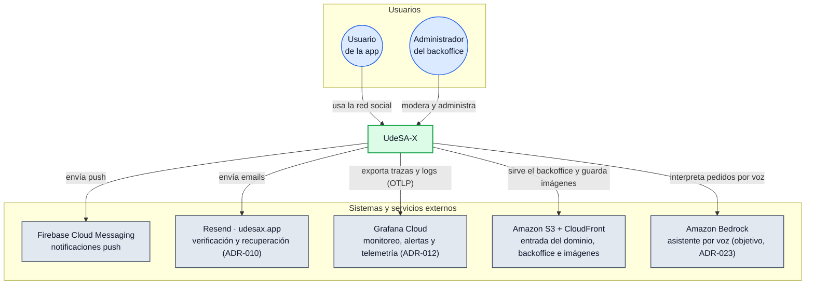
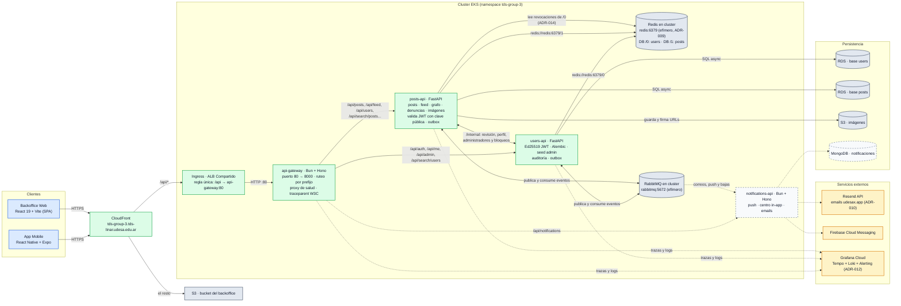
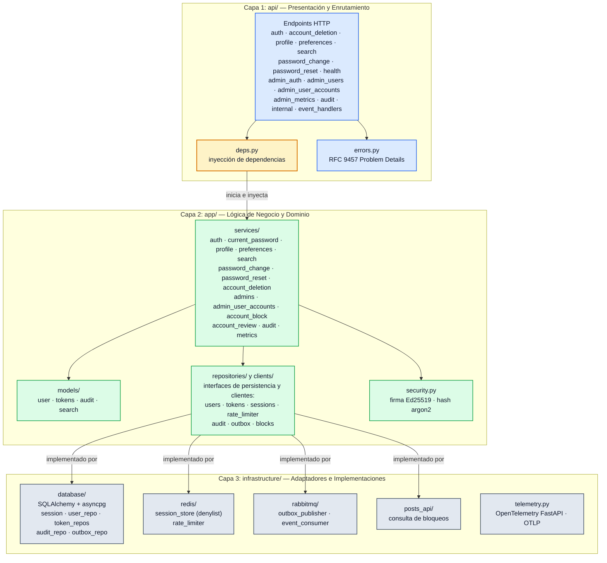
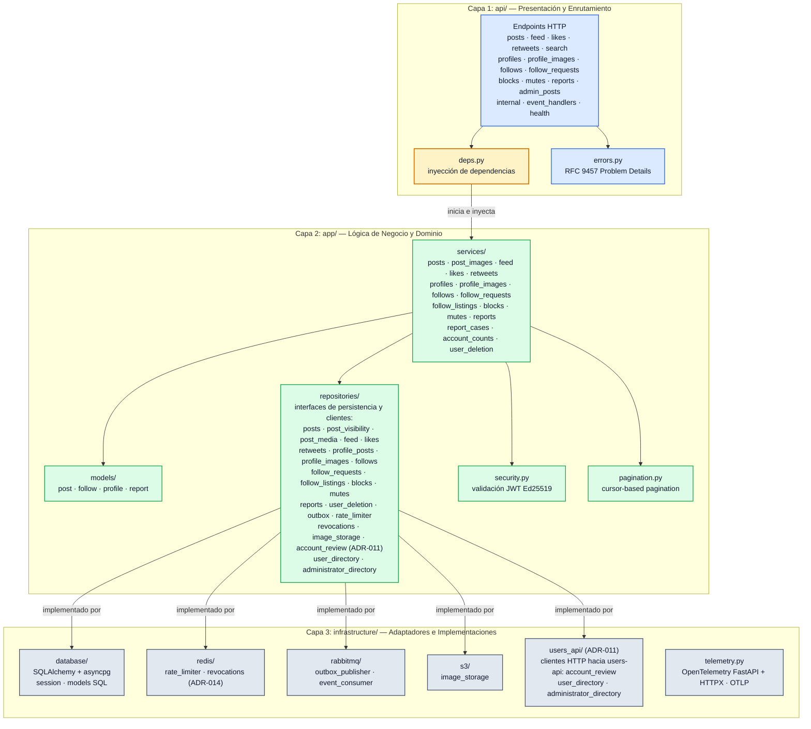

# Diagramas C4 de UdeSA-X

Actualizado a noviembre de 2026. Tres niveles:
Contexto, Contenedores y Componentes. Sin Nivel 4: casi nunca aporta, y menos en un sistema de
este tamaño.

En Mermaid con `flowchart` genérico, no con la sintaxis nativa `C4Context`/`C4Container`: esa
sigue siendo experimental, con limitaciones en tags, leyendas y layout. `flowchart` es también lo
que usa el resto de los diagramas de `ARQUITECTURA.md`, manteniendo un solo estilo visual en todo
el repositorio.

Cada nivel cierra con una nota de qué muestra y qué deja afuera.

## Nivel 1 — Contexto

Quiénes usan el sistema y con qué sistemas externos interactúa, organizado con flujo jerárquico
descendente (usuarios arriba, sistema al centro y dependencias externas abajo) para evitar cruces
de líneas.

**Qué muestra:** los usuarios reales y los sistemas externos con los que el ecosistema se conecta.
Grafana Cloud recibe la telemetría OTLP y hace el monitoreo sintético y la alerta de caídas por email
(ADR-012). S3 y CloudFront sirven el backoffice y las imágenes. Resend (ADR-010) y FCM los usa
`notifications-api`, que tiene código en `main` pero todavía no tiene despliegue. Bedrock lo va a
usar `assistant-api`, que todavía no tiene despliegue (ADR-023).
**Qué deja afuera:** la arquitectura interna de `UdeSA-X` (desglosada en el Nivel 2) y la topología
de red de Kubernetes (`ARQUITECTURA.md`, ADR-008 y ADR-009).

---

## Nivel 2 — Contenedores

Organizado de izquierda a derecha (`flowchart LR`) siguiendo el camino natural del tráfico
HTTP: clientes a la izquierda, CloudFront, Ingress y API Gateway al centro, microservicios
procesando y comunicándose, y almacenamiento y servicios externos a la derecha.

- ✅ **Con despliegue automático desde `main`.** `api-gateway`, `users-api`, `posts-api`, Redis,
  RabbitMQ y el backoffice en S3 + CloudFront, más el Ingress compartido y RDS.
- 🚧 **Con código en `main`, sin despliegue todavía.** `notifications-api` (Bun + Hono) y su MongoDB.
  Hasta entonces nadie consume sus eventos, entre ellos los que disparan los correos de la cuenta.
- 🚧 **Con código, sin endpoint ni despliegue todavía.** `assistant-api`, el asistente por voz sobre
  Bedrock: el bucle del agente y sus evaluaciones (ADR-023 y `SPIKE-IA.md`).

Las líneas punteadas hacia `notifications-api` muestran cómo va a quedar conectado.

### Detalles operativos de los contenedores

1. **Backoffice**: SPA compilada con React 19 + Vite. Se publica en un bucket privado de S3 y
   CloudFront la distribuye globalmente por HTTPS. No utiliza pods ni consume cuota de Kubernetes.
   El navegador del administrador llama a `/api` en el mismo dominio (`VITE_API_URL`), y CloudFront
   lo manda al ALB.
2. **App Mobile**: React Native + Expo. Los clientes instalados usan ese mismo dominio por HTTPS
   (`EXPO_PUBLIC_API_URL`).
3. **Ingress y api-gateway**: La entrada al cluster la provee el AWS Load Balancer Controller con un
   Application Load Balancer compartido (`tds-shared`). La regla única rutea todo `/api` hacia el
   `api-gateway` (puerto 80 → 8000). El gateway resuelve los destinos según el prefijo de la ruta,
   descarta el header `Host` original, inyecta el encabezado `traceparent` de OpenTelemetry y delega la
   respuesta upstream.
4. **Salud centralizada y alertas**: El gateway expone `/api/health/:service`, consultando el
   `/healthcheck` privado de `users-api` y `posts-api` con un timeout estricto de 5 segundos. Synthetic
   Monitoring de Grafana Cloud sondea estos endpoints cada 2 minutos y dispara alertas automáticas
   por email a los administradores ante caídas de servicio (ADR-012).
5. **Comunicación interna entre microservicios**:
   - `users-api` y `posts-api` son autónomos para validar tokens JWT: `users-api` firma con su clave
     privada Ed25519, y `posts-api` verifica con la pública y comprueba el `issuer` esperado sin realizar
     llamadas de red. La revocación la consulta `posts-api` en el Redis de `users-api` (base `/0`,
     solo lectura, falla cerrado; ADR-014).
   - Las **llamadas síncronas REST** entre microservicios van por rutas `/internal`, con el DNS del
     cluster, sin pasar por el gateway ni por el Ingress, y se autentican con un secreto compartido
     en el header `X-Internal-Token`. `posts-api` llama a `users-api` para poner o sacar una cuenta
     de revisión al llegar a 6 denunciantes únicos o al cerrar el caso (ADR-011), y para leer el
     perfil público y la identidad de un administrador. `users-api` llama a `posts-api` para saber
     si hay un bloqueo.
   - Lo **asíncrono** va por RabbitMQ con patrón outbox: cada servicio escribe el evento en la misma
     transacción que su cambio, y otro proceso lo publica. `users-api` publica los eventos de la
     cuenta y `posts-api` los de follows e interacciones. `notifications-api` es quien consume para
     mandar correos y push. Los contratos están en `docs/eventos/` (ADR-017).
6. **Bases de datos y caché**:
   - PostgreSQL reside en una instancia de RDS (PostgreSQL 18.3, sin acceso público) con una base
     y un rol por servicio (ADR-021). La conexión va cifrada con TLS (`ssl=require`), verificando
     el certificado contra las raíces de RDS que trae cada imagen. Los cambios de esquema se aplican
     exclusivamente con Alembic mediante Kubernetes Jobs previos al despliegue de los pods.
   - Redis corre dentro del namespace en un único pod efímero (`k8s/redis.yaml`, Redis 8-alpine,
     sin PVC ni persistencia en disco, política `noeviction` con límite de memoria de 192 MB).
     `users-api` opera sobre la base lógica `/0` y `posts-api` sobre `/1`, y además lee de `/0`
     las marcas de revocación de sesión (ADR-014).

**Qué muestra:** los contenedores con su flujo de datos, protocolos, puertos y servicios externos,
y con línea punteada `notifications-api`, que todavía no se despliega.
**Qué deja afuera:** `assistant-api`, que todavía no tiene código (ADR-023).

---

## Nivel 3 — Componentes de los microservicios

Tanto `users-api` como `posts-api` adoptan una arquitectura en capas limpias con inversión de
dependencias (`ADR-006` y `ADR-007`).

Los diagramas están estructurados en capas estrictamente secuenciales de arriba hacia abajo:
1. **Capa 1: `api/`** (Presentación, controladores y wiring).
2. **Capa 2: `app/`** (Reglas de negocio, servicios, modelos de dominio e interfaces de repositorios/clientes).
3. **Capa 3: `infrastructure/`** (Adaptadores técnicos concretos que implementan las interfaces).

Esta orientación unidireccional vertical garantiza líneas limpias, rectas y sin bifurcaciones
cruzadas.

### Componentes de `users-api`

`api/deps.py` actúa como la raíz de composición: resuelve e inyecta las instancias de
`infrastructure/` que satisfacen los repositorios y clientes que `app/services` requiere.
`internal.py` expone, entre otras, `POST /internal/users/{id}/review`, que invoca `account_review.py`
para poner la cuenta en revisión y revocar sus credenciales activas. Los correos ya no salen de este
servicio: `users-api` deja el evento en la outbox y los manda `notifications-api`.

---

### Componentes de `posts-api`

`posts-api` implementa el cliente `HttpAccountReview` en `infrastructure/users_api/`
como una implementación de la interfaz `AccountReview` declarada en `app/`. Cuando
`reports.py` registra una sexta denuncia única sobre una cuenta, este cliente realiza la llamada
HTTP hacia `users-api` con el header `X-Internal-Token` propagando el contexto de telemetría
(traceparent).

---

### Estructura de `api-gateway` y `backoffice`

- **api-gateway** (Bun + Hono):
  - `routing.ts`: tabla declarativa de prefijos (`/api/auth`, `/api/me`, `/api/admin`, `/api/search/users` hacia `users-api`; `/api/users`, `/api/follow-requests`, `/api/posts`, `/api/feed`, `/api/blocks`, `/api/mutes`, `/api/reports`, `/api/admin/posts`, `/api/search/posts` hacia `posts-api`; `/api/notifications` hacia `notifications-api`; el prefijo más específico va primero) y mapeo de `HEALTH_TARGETS`.
  - `telemetry.ts`: middleware de observabilidad OpenTelemetry que genera o propaga el `trace_id` e inyecta encabezados W3C `traceparent` a las llamadas upstream.
  - `app.ts`: enrutador Hono con reverse proxy HTTP, timeout de 5 segundos en chequeos de salud `/api/health/:service`, y endpoints locales `/healthcheck` y `/livez`.
- **backoffice** (React 19 + Vite):
  - `features/`: módulos funcionales desacoplados (`auth`, `users`, `health`, `moderation`, `dashboard`, `audit`).
  - `services/apiClient.ts`: cliente Axios con interceptor de bearer token, timeout de 10s y parseo unificado de RFC 9457 Problem Details (`toApiError`).
  - `stores/authStore.ts`: store Zustand para gestión de sesión y credenciales.

---

## Referencias

- `docs/ARQUITECTURA.md` — arquitectura objetivo y decisiones de stack
- `docs/adr/ADR-005-limites-de-servicios.md` — distribución de responsabilidades
- `docs/adr/ADR-006-inversion-de-dependencias.md` — desacoplamiento de capas
- `docs/adr/ADR-007-estructura-por-capas.md` — arquitectura limpia en microservicios
- `docs/adr/ADR-008-plataforma-de-despliegue.md` — cluster compartido EKS
- `docs/adr/ADR-009-bases-gestionadas-y-migraciones.md` - Redis en cluster y migraciones (PostgreSQL reemplazado por el ADR-021)
- `docs/adr/ADR-010-proveedor-de-correo.md` — Resend con dominio `udesax.app`
- `docs/adr/ADR-011-denuncias-y-cuenta-en-revision.md` — llamada síncrona interna posts-api → users-api
- `docs/adr/ADR-012-monitoreo-de-servicios-y-alerta-de-caida.md` — Grafana Cloud Synthetic Monitoring y Alerting
- `docs/adr/ADR-014-revocacion-de-sesiones-en-posts-api.md` - posts-api lee las marcas de revocación del Redis de users-api
- `docs/adr/ADR-017-forma-y-versionado-de-eventos.md` - contratos de los eventos
- `docs/adr/ADR-021-postgresql-en-rds.md` - PostgreSQL en RDS, una base y un rol por servicio
- `docs/adr/ADR-023-bedrock-para-el-asistente-por-voz.md` - asistente por voz sobre Bedrock
