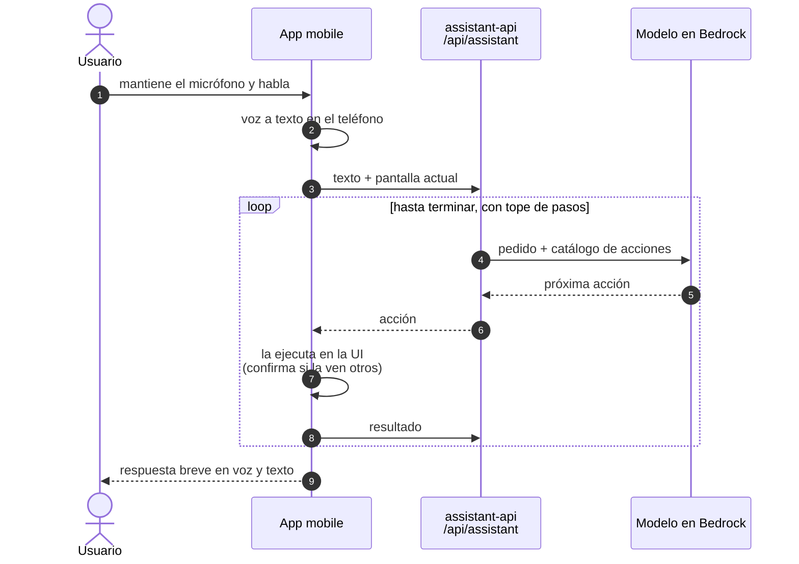

# Funcionalidad de IA: asistente por voz que maneja la app

**Fecha:** 2026-10-27 · **Estado:** acordada con el tutor el 2026-10-26 · **Issue:**
`udesa-x-platform#88` (`AI-01`)

## Qué queremos resolver

Hacer algo en la app mobile lleva varios toques repartidos en varias pantallas: buscar a
alguien y seguirlo, publicar, contestar un post, cambiar una preferencia. Para quien tiene las
manos ocupadas o una dificultad motriz o visual, cada uno de esos pasos es una barrera.

La funcionalidad deja pedir eso con la voz ("buscá a Fede Trejo y seguilo") y un agente lo
hace **en la interfaz, a la vista del usuario**: navega, completa los campos y se detiene a
pedir confirmación antes de cualquier cosa que vean otros. No es un atajo escondido contra la
API: el agente usa las mismas pantallas y los mismos permisos que el usuario.

## Cómo lo resolvemos

- **Voz a texto en el teléfono.** `expo-speech-recognition` usa el reconocedor de iOS o de
  Android, en `es-AR`, sin costo. Al backend llega texto, nunca audio. La respuesta se lee con
  `expo-speech`. Es pulsar para hablar: no hay escucha continua ni palabra de activación.
- **El modelo decide, la app ejecuta.** Con tool use, el modelo no llama a la API: elige una
  acción de un catálogo fijo y la app la ejecuta como si el usuario tocara la pantalla. Cada
  acción le devuelve al modelo qué pasó y qué se ve, y con eso decide la siguiente.
- **Catálogo acotado.** Navegar a una pantalla, buscar, abrir un perfil, leer lo que hay en
  pantalla, redactar un post o una respuesta, seguir, dar like, retuitear y cambiar tema o
  idioma. Borrar, bloquear, denunciar, cambiar la contraseña o cerrar la cuenta **no están en
  el catálogo**: el agente puede llevar al usuario a esa pantalla, pero la acción la hace él.
- **Confirmación de lo que ven otros.** Publicar, responder, seguir y retuitear muestran una
  tarjeta con lo que se va a hacer, y se confirma con un toque o diciendo "sí".
- **Dónde corre.** Un servicio propio, `assistant-api`, en FastAPI y Python, con sus
  evaluaciones, tests y playground en el mismo repo. Es un relay: guarda las credenciales de
  Bedrock, arma el pedido y aplica los topes. El gateway suma la ruta `/api/assistant`. Lo
  decide el ADR-023: la primera versión lo ponía en `notifications-api`, y el tutor sugirió
  separarlo.
- **Modelo.** En Amazon Bedrock. Arranca con gpt-oss-120b, de costo medio entre diez
  candidatos (Nova, Nemotron, GLM, Gemma, Ministral, gpt-oss, Qwen, Llama y Claude Haiku 5.5),
  y se ajusta con las evaluaciones de `AI-03` hasta el más barato que cumpla, con Claude
  Sonnet 5.5 solo como referencia de calidad. Lo decide el ADR-023, con la estimación de
  `ESTIMACION-COSTOS-IA.md`.
- **Límites.** Tope de pasos por pedido, tiempo límite por llamada al modelo y rate limit por
  usuario. Al modelo llega el pedido y lo que hay en pantalla, nunca tokens, emails ni ids
  internos. Ningún texto del usuario va a logs ni trazas, que salen a Grafana Cloud (ADR-013).

## Resultado esperado

En la demo, con el micrófono del shell de la app:

1. "Buscá a Fede Trejo y seguilo": la app abre Buscar, escribe, abre el perfil y muestra
   "¿Seguir a @fede?". Con "sí", lo sigue.
2. "Publicá que llego tarde a la clase de las 10": se abre el compositor con el texto escrito y
   el usuario confirma la publicación.
3. "Dale like al último post de Tomi": la app va a su perfil y le da like al primero.
4. "Poné el modo oscuro": cambia la preferencia y lo dice en voz.

**Criterio de éxito.** Un set de 25 pedidos guionados sobre datos de prueba, medido en
`AI-03`: al menos 80% terminados bien, ninguna acción visible para otros sin confirmación y una
mediana menor a 3 segundos entre el fin de la frase y la primera acción en pantalla.

**Fuera de alcance.** El backoffice, la escucha continua y las acciones fuera del catálogo.

## Qué se descartó

Las versiones anteriores de este documento proponían el mapa de la conversación, el feed
"Para vos" explicable y el triage asistido de denuncias, con modelos abiertos en el cluster. La
medición preliminar del 2026-10-17 mostró que el LLM que entra en la cuota no clasifica con la
confianza necesaria, y el triage dependía de piezas que todavía no existen. Con
un modelo hosteado, el asistente por voz es la opción que más se ve en la app y que más aporta
al usuario. Reemplaza la decisión del ADR-016; la vigente es el ADR-023.

## Lo que sigue

- `AI-02`: ADR-023, con proveedor, credenciales de Bedrock, datos enviados y estimación de
  costos. Reemplaza al ADR-016.
- `AI-03`: spike de punta a punta con tres acciones y el set de pedidos del criterio de éxito.
- `AI-04` a `AI-07`: se reescriben para el relay, la integración en la app, los tests y los
  límites del asistente.
